#! Declaration

I declare that this report and the software it describes are my own work, carried out under the supervision of Assoc. Prof. Dr. Võ Thị Ngọc Châu. Knowledge, data and source code taken from other authors are cited in the text and listed in the references; no part has been copied from another source without acknowledgement. The experimental results were produced by the code in the project repository and can be reproduced from the stored inputs and run records.

If this declaration is found to be untrue, I take full responsibility before the Faculty of Computer Science and Engineering and the University.

[right] Ho Chi Minh City, November 2026

[right] **Võ Văn Dũng**

#! Acknowledgements

I sincerely thank Assoc. Prof. Dr. Võ Thị Ngọc Châu for her guidance throughout the CO5103 project. Her four requests after the preliminary report - more benchmark data, more recent references, a comparison table and an implemented, evaluated model - shaped the direction of the work, and her comments at each progress review kept the project focused on what makes a schedule trustworthy for management rather than on a single algorithm.

I also thank the lecturers of the Master of Management Information Systems programme at Ho Chi Minh City University of Technology for the knowledge that this project builds on.

[right] **Võ Văn Dũng**

#! Abstract

Many medium and large component plants in Vietnam still plan production in separate Excel files maintained by individual planners. Orders, stock and machine status are scattered across departments, rush orders are absorbed by hand, and management cannot see the reasoning behind a schedule. This project builds a production scheduling agent that produces **reasonable schedules** - schedules that respect every physical and business constraint of the plant and balance service against operating cost on explicit grounds - and delivers it as a working information system. The case study is an alloy wheel line with five stages (casting, heat treatment, CNC machining, painting, test and packing), modelled as a flexible job-shop scheduling problem with shifts, shared molds and their maintenance, sequence-dependent setups, stage-specific lots, work-in-progress buffers, safety stock and order deliveries.

Experiments with eight single algorithms (FIFO, EDD, SPT, simulated annealing, a genetic algorithm, CP-SAT, CP-SAT with a hint, CP-LNS) showed that none is best everywhere: monolithic CP-SAT found no schedule for a two-week period even after 12 hours, while CP-SAT warm-started from a simulated-annealing schedule produced the best schedules and proved that the service level was optimal. The proposed solution therefore combines the algorithms in one pipeline (dispatching rules, multi-seed simulated annealing, warm-started CP-SAT), checks every schedule with an independent validator, filters the non-dominated options and lets the planner choose under an explicit policy, edit a schedule by hand and let the solver optimise the rest. On the two-week dataset, the product's Hybrid method reaches zero late orders within one minute and proves the service level optimal within minutes; after nine minutes it uses 53 machine-shifts instead of the 95 of the earliest-due-date rule. The system (FastAPI backend, Next.js frontend, SQLite database) also supports a versioned factory set-up, an order book with Excel import, planning periods, rescheduling after incidents, what-if variants, explanations of late orders and an audit trail. A public demonstration with an English sample plant runs at https://mnft-frontend.onrender.com.

**Keywords:** production scheduling, flexible job shop, CP-SAT, simulated annealing, hybrid optimisation, multi-objective, decision support, management information system.

#! Contents

[[TOC]]

#! List of Figures

[[LOF]]

#! List of Tables

[[LOT]]

#! Abbreviations

| Abbreviation | Meaning |
|---|---|
| API | Application programming interface |
| APS | Advanced planning and scheduling (software) |
| CP | Constraint programming |
| CP-SAT | The constraint programming / SAT solver of Google OR-Tools |
| CP-LNS | Large neighbourhood search with CP-SAT solving the reopened part |
| EDD | Earliest due date (dispatching rule) |
| FIFO | First in, first out (dispatching rule) |
| FJSP | Flexible job-shop scheduling problem |
| GA | Genetic algorithm |
| JSP | Job-shop scheduling problem |
| LNS | Large neighbourhood search |
| MES | Manufacturing execution system |
| MIS | Management information system |
| RPD | Relative percentage deviation |
| SA | Simulated annealing |
| SPT | Shortest processing time (dispatching rule) |
| UC | Use case |
| WIP | Work in progress (semi-finished stock between stages) |
| XAI | Explainable artificial intelligence |

# 1. Introduction

This chapter describes the business problem behind the project, states its aims and objectives, defines its scope and summarises its contributions.

## 1.1. Context and challenges

In many medium and large component plants (reference case: a medium-to-large wheel manufacturer in Vietnam), production scheduling still revolves around separate Excel files that each planner maintains from personal experience. Orders, stock and machine status are spread over files kept by different departments (planning, warehouse, production); they drift out of sync and nobody owns "the correct version". Management therefore has no single, reliable source of data to monitor operations and decide in time. Five challenges stand out:

- **Fragmented, uncontrolled data.** Each department keeps its own spreadsheet, without synchronisation or change history, so figures diverge and reports require long manual reconciliation.
- **A "black box".** Even with figures at hand, managers cannot see the logic behind scheduling decisions, which lives in the planner's experience rather than in a system.
- **Slow reaction to disruptions.** A rush order or a machine breakdown cuts into an existing plan, and every change must be traced and edited by hand.
- **Dependence on individuals.** The know-how is hard to standardise or scale and is lost when key people leave or rotate.
- **Many constraints at once.** Limited bottleneck machines, changeover times between product types, product-specific machines, minimum lot sizes, periodic mold maintenance, stock levels, and the requirement that machines already switched on are used well, so that no energy or labour is wasted.

The problem is also hard in principle. Shop scheduling belongs to the NP-hard problem classes [1, 12]: the number of possible sequences grows explosively with the number of jobs, so a planner can rarely check more than a few alternatives by hand. Labour and energy for idle machines inside an opened shift are paid by the plant, and late deliveries to demanding customers damage the relationship. A system that builds schedules automatically, checks them rigorously and explains them is therefore both a technical and a management need.

## 1.2. Aims and objectives

**Overall aim.** Design and build a production scheduling agent that generates reasonable schedules for a wheel production line and delivers them through a management information system that planners and managers can trust.

**Specific objectives:**

1. Model the scheduling problem of a five-stage line as an extended flexible job-shop problem: shifts, shared molds, changeovers, stage lots, stock and deliveries.
2. Generate optimal or near-optimal schedules automatically by combining several algorithms, and check every schedule with an independent validator.
3. Present options on the trade-off between service level and operating cost, so that management chooses on explicit grounds.
4. React to rush orders and breakdowns by replanning the rest of the period while keeping what has already been executed.
5. Maximise machine utilisation inside every opened shift, reducing wasted labour and energy.
6. Evaluate the solution on self-built business datasets and prepare public benchmarks for the scheduling core.

## 1.3. Scope

- **Master data:** machines, products and routes, processing times per stage, product and machine, machine capabilities, changeover matrices, lot sizes per stage, molds (life and maintenance cycle), shifts (three per day), labour cost per shift.
- **Transaction data:** customer orders with product, quantity, due date, priority and customer.
- **Production planning (monthly/quarterly):** aggregate the orders of a month or quarter into demand for each two-week period, following the hierarchical production planning model of Hax & Meal [16]. This tier works at the aggregate level and does not need its own optimisation model.
- **Detailed scheduling** of a simplified line (front and rear wheels) with **five stages: casting → heat treatment → CNC machining → painting → test and packing**. *(The preliminary report used four stages. After analysing a real 19-operation aluminium alloy wheel process, heat treatment was added because it is the longest operation and the bottleneck of the line; see Section 4.2.)*
- **Stock** (opening stock, work in progress between stages, safety stock and warehouse capacity per product) is part of the constraints, not a separate inventory optimisation problem.
- **Explanation** of every schedule is a supporting feature that helps management trust it, not a goal in itself.

**Out of scope:** a direct connection to machines (MES/IoT) - incidents are entered by the planner; deployment in a real plant - the system runs at prototype level with synthetic, documented data.

## 1.4. Contributions

- **Methodological:** a combined scheduling pipeline in which each algorithm is placed where the experimental evidence shows it works, with an independent validator that makes schedules from different algorithms - and from people - comparable with the same yardstick.
- **Empirical:** an evaluation of ten scheduling methods on two business datasets, including a proof that the service level of the two-week dataset is optimal and the measured effect of the machine-utilisation objective.
- **Practical (information system):** a working web system that covers the planner's whole cycle - factory set-up, order book, period preparation, option generation, comparison, hand editing, commitment with an audit trail, execution and rescheduling - documented by a 91-page user guide and a narrated demo video, and available as a public demonstration.
- **For the course requirements:** a 17-row literature comparison, a survey of public benchmark data and open-data portals, and reproducible experiment records.

## 1.5. Structure of the report

Chapter 2 presents the theoretical background. Chapter 3 reviews related work, related software and benchmark data. Chapter 4 describes the design and implementation of the solution: data, model, algorithms and the information system. Chapter 5 reports testing, experimental evaluation and deployment. Chapter 6 concludes with results, limitations and future work. The appendices give detailed use cases and the database design.

# 2. Theoretical background

This chapter introduces the concepts the solution relies on: the hierarchy of planning and scheduling decisions, the classes of scheduling problems, multi-objective optimisation, the main families of solution methods, and rescheduling and explanation.

## 2.1. Hierarchical planning and scheduling

Production management splits decisions by time horizon. **Planning** (monthly or quarterly) decides how much of which product to make in which period. **Scheduling** (daily or weekly) decides which job runs on which machine and when. The hierarchical model of Hax & Meal [16] solves each level with a suitable method, the upper level feeding the lower one. The project follows this structure: the planning tier aggregates orders into demand for each two-week period; the scheduling tier is the main optimisation problem.

## 2.2. Classes of scheduling problems

**Job shop (JSP).** Each job is a sequence of operations in a fixed order, each on a predetermined machine. The JSP is a classical NP-hard class with well-known benchmarks by Taillard and Lawrence [1, 2].

**Flexible job shop (FJSP).** Each operation chooses a machine from a set of eligible machines, so both the assignment and the sequence must be decided [12]. Because all products of this project visit the stages in the same order, the problem is also close to the **hybrid flow shop**, a multi-stage line with parallel machines at each stage [21].

**Real-world extensions** required by the project follow these surveys and Allahverdi's survey of setup times [22] (Table 1).

Table: Real-world extensions of the scheduling problem required by the project

| Extension | Meaning |
|---|---|
| Sequence-dependent changeovers | Switching from product A to B takes a different time than from B to A |
| Secondary resources (molds) | An operation needs a machine and a mold at the same time; molds have a life and a maintenance cycle |
| Stage-specific lots and batches | Each stage has its own lot size (the furnace runs in batches); stages are linked through work-in-progress buffers |
| Shift calendars | Machines only work in opened shifts; opening a shift costs labour |
| Stock and deliveries | Safety stock, warehouse capacity, delivery per order and due date |

## 2.3. Multi-objective scheduling

A production schedule must balance conflicting objectives: on-time delivery, safety stock, fewer changeovers and fewer opened shifts. Three common approaches exist:

- **Weighted sum:** combine the objectives into one score. It is simple, but one objective can compensate another - saving cost can offset late delivery.
- **Lexicographic order:** optimise the most important objective first and compare the next one only on ties.
- **Pareto optimality:** a schedule is **non-dominated** if no other schedule is at least as good on every objective and better on one. The non-dominated set forms the **trade-off curve**. The **ε-constraint** method generates points of this curve by bounding one objective by ε and optimising the others.

When the weights between objectives are a management policy rather than a measurable quantity, the Pareto approach has an advantage: instead of fixing the weights in advance, the system presents trade-off options and the manager chooses.

## 2.4. Families of solution methods

Table 2 summarises the main families of methods for shop scheduling; the subsections describe those used in the project.

Table: Families of solution methods for shop scheduling

| Family | Examples | Strengths | Weaknesses |
|---|---|---|---|
| Dispatching rules | FIFO, EDD, SPT | Instant, easy to understand, close to manual planning | Low quality, myopic |
| Metaheuristics | Simulated annealing (SA), genetic algorithm (GA) | Flexible, improve gradually, scale well | No optimality guarantee, seed dependent |
| Constraint programming | OR-Tools CP-SAT [4]; CP-SAT vs. CP Optimizer in PyJobShop [9] | Natural modelling of complex constraints; lower bounds measure the distance to optimality | Solving time grows quickly with size |
| Hybrid CP + search | Large neighbourhood search (LNS): reopen part of the schedule for CP | Uses CP on small sub-problems | No global bound |
| Time decomposition | Rolling horizon: solve consecutive windows [13] | Handles long horizons | Each window cannot see far ahead |
| Machine learning | Reinforcement learning, graph neural networks [23-25], CP with deep learning [26] | Fast decisions after training | Needs training data, hard to explain |

### 2.4.1. Dispatching rules

A dispatching rule builds a schedule step by step: whenever a machine becomes free, it picks the next waiting job by a simple priority - arrival order (FIFO), earliest due date (EDD) or shortest processing time (SPT). Rules are instant and mirror how planners schedule by hand, which makes them a natural baseline and a fallback, but they look only at the current decision and cannot trade a small delay now for a large gain later.

### 2.4.2. Metaheuristics: simulated annealing and genetic algorithms

Metaheuristics search over an encoding of the schedule (for example a priority order of operations) and use a **decoder** to turn each encoding into a feasible schedule. **Simulated annealing** moves from one solution to a neighbour and sometimes accepts a worse one, with a probability that decreases over time (the "temperature"), so that it can escape local optima. A **genetic algorithm** evolves a population of solutions by selection, crossover and mutation. Both scale well to large instances but give no guarantee of optimality, and their results vary with the random seed.

### 2.4.3. Constraint programming with CP-SAT

In CP-SAT each operation is an **interval variable** (start, duration, end). A **no-overlap** constraint ensures a machine never does two jobs at once; cumulative and logical constraints express molds, shifts and stock. The solver combines clause learning from SAT solvers with linear relaxations and runs several search strategies in parallel. Two features are central to this project: the solver can take a **hint schedule** as a starting point, and it reports a **lower bound**, so the distance to optimality of the best schedule is known. Its weakness is scale: without a good start, the time to find a first solution can grow very quickly.

### 2.4.4. Large neighbourhood search and rolling horizon

**Large neighbourhood search** keeps most of a schedule fixed and reopens a part of it - a time window, a few machines or a random subset - for CP to re-optimise; repeating this improves the schedule while each sub-problem stays small. A **rolling horizon** splits a long period into overlapping windows solved one after another. Both reduce problem size, at the cost of losing the global bound (LNS) or the view of later due dates (rolling horizon).

## 2.5. Rescheduling and explanation

**Rescheduling.** Vieira et al. [31] distinguish rescheduling strategies, policies (when to reschedule) and methods (what to repair). After a rush order or a breakdown, the part of the schedule already executed must stay fixed and only the future is replanned.

**Explanation.** Managers need to understand why a schedule looks the way it does before trusting it. Related techniques include:

- the **critical path** [14], the chain of operations that determines completion;
- **sensitivity analysis**, relaxing constraints one at a time to find bottlenecks [15];
- **counterfactual explanations**, "if X changed, how would the schedule change?" [7];
- **XAI frameworks for operations research** [17, 18].

For a multi-objective problem, **presenting the trade-off between options** is itself an explanation: users see what each gain costs.

## 2.6. Summary

Scheduling a multi-stage line with molds, shifts and stock is an extended FJSP, an NP-hard problem for which no single family of methods dominates: rules are instant but myopic, metaheuristics scale but give no guarantee, and CP gives guarantees but struggles with size. Multi-objective thinking and explanation turn the result from a single "optimal" schedule into a decision that management can make and justify. These observations motivate the combined solution of Chapter 4.

# 3. Related work

This chapter reviews research on the problem, compares the closest works with this project, surveys related software, lists the public benchmark data and identifies the gap the project addresses.

## 3.1. Overview by research direction

- **Specific production constraints.** Cheng et al. [8] solve an FJSP with machine-mold coordination and mold setup times by multi-objective differential evolution. Ghaleb et al. [20] schedule in real time together with condition-based maintenance. Deliktaş et al. [10] publish 43 FJSP instances with family-dependent setup times.
- **Constraint programming.** PyJobShop (Lan & Berkhout) [9] packages CP for many scheduling classes and compares CP-SAT with CP Optimizer on more than 9,000 public instances.
- **Machine learning for scheduling.** Zhang et al. [23] learn dispatching rules with deep reinforcement learning; Song et al. [24] extend this to the FJSP with graph neural networks; Smit et al. [25] survey GNN approaches; Li et al. [13] learn which variables to fix between rolling-horizon windows; Echeverria et al. [26] combine CP with deep learning for the dynamic FJSP; Chalumeau et al. [32] use reinforcement learning inside a CP solver.
- **Explanation.** Wang & Chen [5, 6] build XAI techniques for GA results in scheduling. Mehdiyev et al. [7] use multi-objective counterfactuals. Hu et al. [27] propose readable, programmatic scheduling policies. Liu et al. [28] review architectures of ML-based scheduling decision systems, distinguishing solver-led, shared and model-led configurations.

## 3.2. Comparison table

Table 3 compares the closest works with this project. Cells only contain what could be confirmed from the source; "not confirmed" means the accessible source (often only the abstract) does not state it, not that the work lacks it.

Table: Comparison of related studies with this project

| Study | Problem | Algorithm / method | Specific production constraints | Explanation | Dynamic disruptions | Data |
|---|---|---|---|---|---|---|
| Wang & Chen 2024 (ESWA) [5] | JSP (semiconductors) | GA + XAI post-processing (decision tree, contribution diagram) | No | Yes - after solving | No | Simulated synthetic |
| Wang & Chen 2025 (Springer book) [6] | General JSP | GA + bio-inspired algorithms | Not industry-specific | Yes - systematic XAI framework | No | Synthetic illustrations |
| Mehdiyev et al. 2024 (Cognitive Computation) [7] | JSP (process prediction + optimisation) | Predictive process monitoring + NSGA-II | No | Yes - multi-objective counterfactuals | Implicit (what-if scenarios) | Real process logs |
| Cheng et al. 2024 (IEEE Access) [8] | FJSP + mold resources | Improved multi-objective differential evolution | Yes - machine-mold coordination, mold setup | No | No | Synthetic |
| Ghaleb et al. 2021 (J. Manufacturing Systems) [20] | Dynamic FJSP | Hybrid GA | Yes - machine deterioration, condition-based maintenance | No | Yes - real-time scheduling | Not confirmed |
| Lan & Berkhout 2025 (PyJobShop) [9] | General FJSP/JSP/RCPSP | CP-SAT & CP Optimizer | Generic | No | No | >9,000 public benchmark instances |
| Zhang et al. 2020 (NeurIPS) [23] | JSP | Deep reinforcement learning + graph representation | No | No | Not confirmed | Random and public benchmark instances |
| Song et al. 2023 (IEEE TII) [24] | FJSP | GNN + deep reinforcement learning | No | No | Not confirmed | Random and public benchmark instances |
| Li et al. 2025 (ICLR) [13] | Long-horizon FJSP | Rolling horizon + learned variable fixing | Not specific | No | Not confirmed | Synthetic |
| Echeverria et al. 2025 (ESWA) [26] | Dynamic FJSP | CP combined with deep learning | Not specific | No | Yes | Not confirmed |
| Hu et al. 2026 (arXiv) [27] | Scheduling | Reinforcement learning producing programmatic policies | Not confirmed | Yes - readable, editable policies | Not confirmed | Not confirmed |
| Nedbálek & Novák 2025 (ICORES) [15] | RCPSP | Constraint relaxation to find bottlenecks | Not specific | Yes - identifies bottlenecks | No | Not confirmed |
| Nguyễn Hồng Phúc et al. 2026 (TNU JST) [29] | FJSP + outsourcing | Mathematical model + GA | Yes - overtime, outsourcing | No | Not confirmed | Not confirmed |
| Nguyễn Hữu Mùi & Vũ Đình Hòa 2012 [30] | JSP | GA + local search | No | No | No | Not confirmed |
| Deliktaş et al. 2024 (Data in Brief) [10] | Cellular FJSP + family setups | No prescribed algorithm (dataset) | Yes - family-dependent sequence setups | No | No | 43 public instances |
| Mota et al. 2020 (Zenodo) [11] | Real production line + energy | GA | Yes - measured energy data | No | No | Real measurements |
| **This project (2026)** | 5-stage FJSP, two tiers (planning / scheduling) | **Combined:** dispatching rules + SA/GA + CP-LNS + CP-SAT with ε-constraints, Pareto filter, human choice; the product runs the **Hybrid** pipeline | **Implemented:** 3 shifts/day, sequence-dependent setups, shared molds + cyclic maintenance, stage lots, WIP stock, safety stock, warehouse caps, order deliveries | Trade-off curve, two-schedule comparison, **why an order is late**, score by component; critical path and sensitivity: **planned** | Rush orders, planned stops and **mid-period breakdowns: replan from a cut-off** | 2 self-built synthetic datasets; Taillard, Lawrence, Deliktaş: **data ready, not run yet** |

## 3.3. Research in Vietnam

The preliminary report found only one doctoral thesis from the same university, on a different problem: personal scheduling [19]. This review found two works directly on production scheduling: Nguyễn Hồng Phúc et al. [29], an FJSP with overtime and outsourcing solved by a mathematical model and a GA, and Nguyễn Hữu Mùi & Vũ Đình Hòa [30], a GA for the JSP. Both use constraint sets different from this project (molds, opened shifts, stock).

## 3.4. Related software

Besides research prototypes, plants can use several kinds of software for scheduling. Table 4 positions the project against them. The rows on commercial and open-source products summarise their publicly described purpose; their internals were not tested in this project.

Table: Kinds of scheduling software compared with this project

| Software | Type | How schedules are built | Several options on a trade-off | Independent check of each schedule | Reaction to incidents |
|---|---|---|---|---|---|
| Excel files (current practice) | Spreadsheet | By hand, from experience | No | No | By hand |
| ERP manufacturing modules (e.g. Odoo Manufacturing) | ERP module | Work orders planned against work-centre capacity | No | No | Replanning of work orders |
| Commercial APS (e.g. Siemens Opcenter APS, Asprova) | Licensed planning software | Finite-capacity scheduling with rules and optimisation, interactive Gantt chart | Not assessed | Not assessed | Replanning |
| Solver libraries (e.g. Timefold Solver, PyJobShop [9]) | Developer libraries | Metaheuristics (Timefold) or CP (PyJobShop) on a model written in code | Must be programmed | Must be programmed | Must be programmed |
| **This project (PlanWise)** | Web MIS prototype | Combined pipeline: rules → multi-seed SA → warm-started CP-SAT | **Yes**: Pareto filter + policy ranking | **Yes**: every schedule rebuilt and checked | **Yes**: reschedule from a cut-off, what-if variants |

The comparison clarifies the niche of the project. Spreadsheets and ERP modules record the plan but do not optimise it; commercial APS products are powerful but licensed and closed, and their reasoning is not visible to the user; solver libraries are flexible but are tools for developers, not planners. The project combines a transparent, validated optimisation core with the planner-facing workflow of an information system.

## 3.5. Public benchmark data

Table: Public benchmark datasets collected for the project

| Dataset | Source | Licence | Size | Role in the project |
|---|---|---|---|---|
| Taillard ta01-ta80 | Taillard (1993) [1]; Zenodo archive | CC BY 4.0 | 80 instances | Test the job-shop core (makespan) |
| OR-Library incl. Lawrence la01-la40 | Beasley (1990) [3], Lawrence (1984) [2] | Free for research | 82 instances | Same |
| Cellular FJSP | Deliktaş et al. (2024) [10]; Mendeley Data | CC BY 4.0 | 43 instances (small/medium/large) | Machine choice, family setups |
| Production line - energy | Mota et al. (2020) [11]; Zenodo | MIT | 3 JSON/XLSX files | Reference for time/energy parameters |

The open-data portals suggested by the supervisor were also searched (Table 6).

Table: Open-data portals searched for production scheduling data

| Portal | Search result |
|---|---|
| data.gov (USA) | Tag "manufacturing": mostly industrial production indices, capacity utilisation (Federal Reserve) and energy assessment data. No machine-, stage- or order-level data |
| data.gov.vn | No industrial production or scheduling dataset found. The open-data roadmap for enterprises only starts in 2026 |
| Kaggle | Three unverified candidates: the "Job Shop Scheduling Challenge" competition (2026), "10000 Jobshop Problem data" and "Manufacturing Production Data". They must be downloaded and inspected before use |

Public benchmarks only test the job-shop core. None contains shifts, shared molds, work in progress and order-based deliveries together; the project therefore built its own business-realistic datasets (Section 4.2).

## 3.6. Gap and positioning

The works above already offer strong solutions for individual aspects - molds, maintenance, learned policies, explanation - so the project **does not claim to be the first** to combine them. *(The preliminary report stated that "no work combining all three axes was found"; a broader review showed this claim was not well founded, and it was withdrawn.)* The project targets two gaps:

1. Most works pick **one** algorithm and compare it with others. The experiments of this project (Chapter 5) show that each algorithm is strong in a different region: CP on small instances, metaheuristics on large ones, dispatching rules for instant solutions.
2. Most works return **one** optimal schedule for a fixed objective. In practice the weights between delivery and cost are a management decision that changes from period to period.

The contribution is therefore **to build and validate a combined scheduling solution** for a concrete production line - several algorithms generate schedules, every schedule passes an independent validator, and the planner chooses on the trade-off curve - delivered as a working information system.

# 4. Solution design and implementation

This chapter presents the solution: its overall idea, the data it is built on, the scheduling model, the combined schedule generator and the production method, the validator and option ranking, and finally the information system that delivers them to planners.

## 4.1. Solution overview

The preliminary report chose CP-SAT as the only algorithm. The experiments showed that this is not robust: on the three-day dataset monolithic CP-SAT gave the worst schedule within 30 seconds, and on the two-week dataset it found no schedule within 120 seconds - nor, in the long runs of Section 5.3, after 12 hours on 8 threads. Conversely, when started from the best schedule found by other algorithms, CP-SAT produced the best schedules.

The proposed solution therefore **does not pick one algorithm**. It has three parts:

- **A coordinated portfolio of algorithms:** each algorithm does what it is best at, and the best schedule of one step is the starting point of the next.
- **An independent schedule validator:** every schedule must pass it before it is stored or shown.
- **A human choice step:** the system proposes options on the trade-off curve; the planner chooses according to the period's priorities and records the reason, may edit a schedule by hand and lets the solver optimise the rest.

Figure 1 summarises the pipeline.

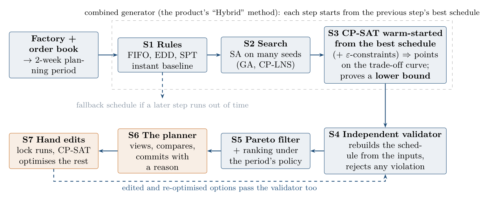

## 4.2. Production process and data

### 4.2.1. Analysis of the production process

To keep parameters realistic, a video of a real aluminium alloy motorcycle wheel process was analysed: 19 operations grouped into 6 phases, reduced to 5 main stages. Heat treatment was added to the preliminary four-stage model because it is the longest operation (8 hours per batch) and the bottleneck of the line. All parameters are **documented estimates**, not plant measurements. Table 7 lists the stages, machines and parameters.

Table: Stages, machines and processing parameters of the wheel line

| Stage | Machines | Run size | Time per run | Changeovers and notes |
|---|---|---|---|---|
| Casting | CAST_1, CAST_2; 4 shared molds | 16 wheels | 74 / 82 min (front / rear) | Mold mounting 60 min, front ↔ rear 60 min; mold maintenance 30 min after 48 (front) / 40 (rear) pours |
| Heat treatment | HT_1, HT_2, running continuously | 24 wheels per rack | 480 min | Every quantity in a rack takes the same time |
| CNC machining | CNC_1, CNC_2 | 20 wheels | 148 / 168 min | Front ↔ rear 18 min |
| Painting | PAINT_1 | 25 wheels | 40 min, then 120 min curing | Silver → black 12 min, black → silver 24 min |
| Test and packing | QC_1 | 20 wheels (one lot = 5 boxes) | 35 min | Product change 4 min |

Machines work three shifts a day (00-08, 08-16, 16-24) with a break from 12:00 to 12:30; the furnaces run continuously. Each transfer between stages waits 10 minutes, and 120 minutes after painting for curing. Each run must fit inside one shift and may not cross the break. There are four finished products - front (F) and rear (R) wheels, each in silver and black - which share semi-finished items until painting. Each stage has a work-in-progress store with opening stock; each finished product has opening stock, a safety stock and a warehouse capacity checked at the end of each day. Each order has a product, quantity, due date and priority (rush orders have priority 4) and is split into test-and-packing lots of 20 wheels. Customers also announce demand for the following weeks; each **build-ahead option** is a group of runs for such a long-dated order that the model may make or skip as a whole, to use idle shifts and protect safety stock.

### 4.2.2. Datasets

Two datasets were generated from these parameters (Table 8). The two-week set keeps the machines, molds, times, changeovers and weights of the three-day set and changes only the period, orders, stock and machine calendar, so that differences in results come from scale. Order quantities of the two-week set are drawn at random with a fixed seed around a mix of 64 F silver, 32 F black, 48 R silver and 28 R black wheels per collection, rounded to boxes of four.

Table: The two experimental datasets

| Feature | Three-day set | Two-week set |
|---|---|---|
| Period | 3 days, 3 shifts/day | 14 days (05-18/10/2026), Sundays off |
| Orders | 4 orders, 108 wheels | 24 orders, 980 wheels; customers collect on Tuesday, Thursday and Saturday at 16:00 |
| Rush orders | 1 (F silver, due 16:00 on day 2) | 2, one per week (due 12:00) |
| Long-dated orders / build-ahead options | 3 / 3 | 4 / 5 |
| Production runs | 42 (29 mandatory + 13 build-ahead) | 269 (240 mandatory + 29 build-ahead) |
| Test-and-packing lots | 5 | 49 |
| Machine stops | CNC_2 stopped 30 min on day 1 | CNC_2 maintenance 4 h on day 4; HT_2 maintenance 8 h on day 9 |
| Opening stock | Safety stock met | F silver and R black open below safety stock; the plan must recover |
| Deliveries | As soon as a lot is finished | Only at the agreed time; finished goods wait in the warehouse and count against its capacity |
| Load of the bottleneck (heat treatment) | 28% (39% with all build-ahead) | 56% (65% with all build-ahead) |
| Manual reference | Hand-made schedule | None |

The **hand-made schedule** of the three-day set was built by reasoning in the way planners usually work - open as few machine-shifts as possible - and is scored by the same validator and objective as the algorithms, representing manual planning.

Data is organised in two layers. **Layer 1** is what the planner enters: machines, molds, shifts, products, stock, orders and long-dated orders. A preparation program derives **layer 2** for the model: lots, the runs of each stage and the build-ahead options. It rejects data when stock cannot cover the part of an order taken from stock, when a build-ahead option exceeds the long-dated demand, or when the load of any stage exceeds its capacity. A third dataset, a **demonstration plant** ("Riverside Alloy Wheels - Plant 1", 156 orders from three kinds of customers, 9 November 2026 to 2 January 2027), was built for the user guide and the demo video.

## 4.3. Scheduling model

The problem is modelled as a five-stage FJSP with the constraints of Table 9; all of them are implemented in the engine used by the product.

Table: Constraints of the scheduling model

| Constraint | Description | Status |
|---|---|---|
| Stage sequence | Casting → heat treatment → CNC → painting → test and packing, with transfer times between stages (e.g. 120 minutes of paint curing) | Implemented |
| Machine capacity and eligibility | One job at a time per machine; each product only on eligible machines | Implemented |
| Sequence-dependent changeovers | Setup time per pair of consecutive items, e.g. paint silver → black 12 min, black → silver 24 min | Implemented |
| Stage lots | Own run size per stage (casting 16, furnace 24, machining 20, painting 25, packing 20), linked through WIP buffers | Implemented |
| Shared molds and maintenance | Molds fit every casting machine; maintenance after a cycle limit | Implemented |
| Shifts | 3 shifts/day; machines only run in opened shifts; furnaces run continuously | Implemented |
| Planned machine stops | Machines unavailable during maintenance windows | Implemented |
| Due dates, safety stock, warehouse caps | Priority-weighted lateness; finished stock at end-of-day checkpoints should reach safety levels and never exceed the cap | Implemented |
| Build-ahead for long-dated orders | Optional: use idle shifts to make part of the orders due after the period, to protect safety stock | Implemented |
| Mid-period incidents | Keep what was executed before a cut-off, replan the future | Implemented (Section 4.8) |

The **objective** has two tiers:

- **Tier 1 - service:** priority-weighted lateness and safety-stock shortfall.
- **Tier 2 - operating cost:** non-productive time inside opened shifts (idle, setup, maintenance), shifts opened, build-ahead and surplus stock.

Scores are written **tier 1 · tier 2**; lower is better and tier 1 is compared first. All schedules are scored with the same weights; how schedules are compared is decided by the **policy** (Section 4.7), not by one fixed sum.

## 4.4. The combined schedule generator

Table 10 shows how the algorithms are combined and why each is placed where it is.

Table: Steps of the combined schedule generator

| Step | Algorithm | Role in the solution | Why it is placed here |
|---|---|---|---|
| S1 | FIFO, EDD, SPT | Valid schedule instantly; baseline and fallback | 42 runs in milliseconds, 269 runs in 0.22 s |
| S2 | SA, GA | Search priority order, machine bias, delays that batch work into fewer shifts, and whether to build ahead | Scale well; best on the two-week dataset |
| S2 | CP-LNS | From the best rule schedule, each round reopens a time window, two machines, one stage or 20% at random for CP-SAT | Best and fastest on the three-day dataset (best schedule after about 9 s) |
| S3 | CP-SAT warm-started from the best schedule, ε-constraints | Bound safety shortfall ≤ ε wheels, minimise lateness then cost; repeat for several ε to build the trade-off curve | With a good start, CP-SAT spends its time improving rather than searching for a first solution, and proves a bound |
| S3' | Rolling-horizon CP-SAT | For long periods: windows of about 60 runs, solved in sequence and joined | Monolithic CP-SAT cannot solve 269 runs; CP handles 60-run windows well |

The combination follows established techniques: warm starts and LNS are common CP-search hybrids, and rolling horizons follow Li et al. [13]. What the project adds is the assembly into one pipeline, with each algorithm placed where the experimental evidence shows it works.

## 4.5. The production method: Hybrid

The long runs of Section 5.3 showed that SA followed by warm-started CP-SAT gives the best schedules, but the experiment needed hours. The product therefore implements this chain as one algorithm, **Hybrid**, that runs within a budget of minutes on all processor cores (Table 11).

Table: The three steps of the Hybrid method

| Step | What it does | Why |
|---|---|---|
| 1. Dispatching rules | FIFO, EDD, SPT; keep the best | A valid fallback in under a second |
| 2. SA on many seeds | One process per seed, same duration: 40% of the budget, at most 90 s. Guided moves pull forward the runs that feed late orders; halfway, the weaker half of the seeds restart from the best one | SA brings late orders down quickly but varies strongly between seeds; idle cores try more seeds |
| 3. CP-SAT | Starts from the best SA schedule with every variable hinted; 2 complete-search workers keep the bound, the others run LNS | Keeps the service level and cuts operating cost by packing runs into fewer shifts |

Each step replaces the previous result only when it is better, so the result is never worse than the best dispatching rule. Five engine changes made this work (measured on the two-week dataset):

1. **Decoder:** positions are computed once per group of interchangeable runs and input-only work is reused; 13 → **30 schedules per second**, producing identical schedules (checked by digest in an automated test).
2. **Guided moves in SA:** 25% of the moves take a run that supplies a late order and swap its priority with an earlier run of the same stage.
3. **Multi-seed SA with one relay:** halfway through, the weaker half of the seeds restart from the best genome.
4. **Complete hints for CP-SAT** (about 13,000 of 52,000 variables were previously unhinted) and removal of ordering arcs already excluded by symmetry constraints; time to the first CP-SAT schedule from EDD: 47 s → **3.6 s**.
5. **Solver configuration with a start schedule:** one presolve pass without probing, 2 complete-search workers, the rest LNS, half the logical cores. From the same SA schedule, 120 s of CP-SAT now reach tier 2 = 49,751 instead of 81,081.

The Generate dialog of the product offers three presets: **Quick** (EDD + Hybrid, 60 s), **Balanced** (180 s, recommended for two-week periods) and **Thorough** (600 s).

## 4.6. The independent schedule validator

Every schedule - whichever algorithm built it, and including hand-made and hand-edited schedules - is rebuilt from the input data and checked again: sequence, machines and molds, setups, maintenance and shifts; work-in-progress and finished stock at every moment; warehouse caps and the allocation of goods to orders. The validator never trusts an algorithm's own "valid" flag, and the automated tests include deliberately broken schedules that it must reject (Section 5.1). This is what makes the combination trustworthy: different algorithms are compared with the same yardstick, and a schedule is only stored after it passes.

## 4.7. Option filtering and policy-based ranking

From all valid schedules, the system keeps the **non-dominated schedules** on three axes: lateness, safety-stock shortfall and operating cost. Options are named after their strength (*Best on every axis*, *Protects priority orders*, *Least shortfall*, *Lowest cost*, *Middle ground*) and show which algorithm built them. The planner chooses the **policy** used to rank them (Table 12).

Table: Policies for ranking schedule options

| Policy | How schedules are compared | When to use |
|---|---|---|
| Service first (default) | Lateness and safety shortfall first; cost only breaks ties | Periods with rush orders or key customers |
| Balanced | All terms added into one weighted score | Normal periods |
| Cost first | Operating cost first; lateness and stock only break ties | Orders can slip; labour must be saved |

A policy only changes the **priority order**, not the weights, so the same set of schedules is re-ranked instantly without solving again.

## 4.8. The scheduling information system

### 4.8.1. System description

The solution is delivered as a web information system, called **PlanWise** in its interface. It lets a planner keep the plant's data in one place, build a two-week schedule from the order book, compare options, decide, and follow the plan through execution; managers can read every schedule and every decision with its reason. Its data model separates information **by how often it changes** (Table 13).

Table: Data layers of the information system

| Layer | Content | Changes |
|---|---|---|
| Factory set-up (versioned) | Stages, run sizes, products and routes, machines with rates and changeover matrices, molds, shifts, rest days, holidays, weekly maintenance, objective policies; every save is an immutable version with an optional effective date | A few times a year |
| Order book | Every order with product, quantity, due date, priority, customer; Excel/CSV import with a row-by-row preview | Continuously |
| Planning period | For one period (14 days by default): orders taken from the book, opening stock projected from the previous committed schedule, mold counters, calendar exceptions, policy, build-ahead options | Every period |
| Derived data | Lots, runs per stage, allocation of stock to orders, checkpoints, machine availability - compiled automatically | Never typed in |

A planning period follows a fixed life cycle (Figure 2): **prepare → generate options → schedule and compare → commit → execute → close and roll over**, the committed closing stock becoming the next opening stock. Two side paths keep the main plan safe: a **what-if variant** copies a period's inputs to test changes, and a **reschedule** creates a new version of the period from a cut-off after an incident.

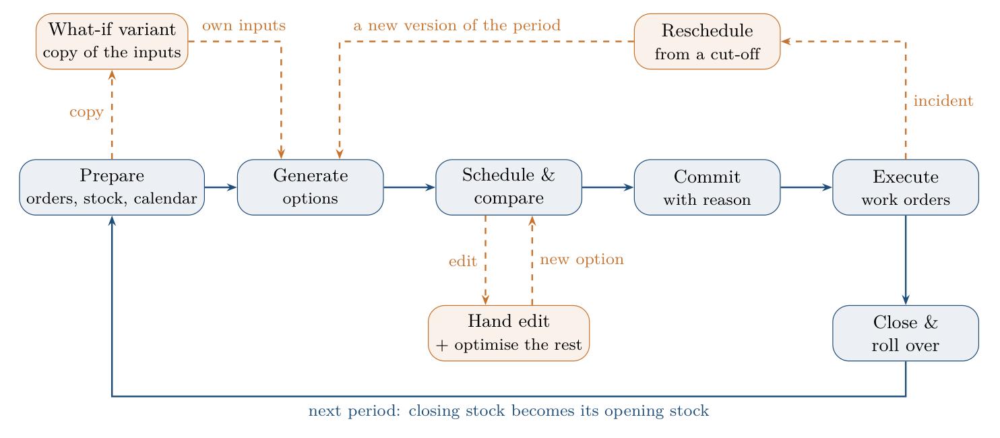

### 4.8.2. Actors and use cases

The system has two human actors, distinguished by the role of their API key: the **planner** (operator role), who changes data and makes decisions, and the **manager** (reader role), who can read everything but change nothing. Figure 3 shows the twelve main use cases; Appendix A details the most important ones.

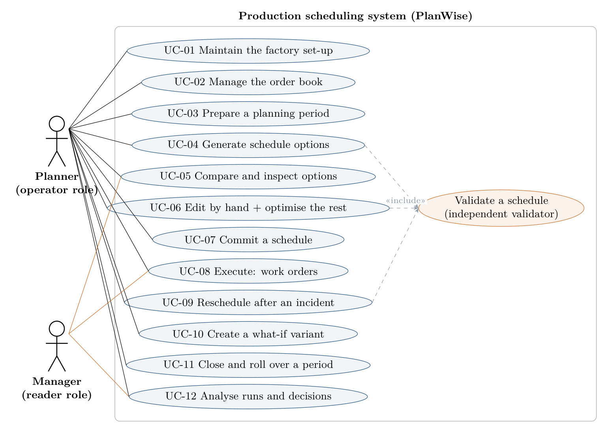

- **UC-01 Maintain the factory set-up:** edit stages, products, machines, molds, calendar and policies; each save becomes a new version, optionally effective from a date.
- **UC-02 Manage the order book:** add, edit and delete orders, or import them from Excel/CSV with a preview.
- **UC-03 Prepare a planning period:** choose the orders, check opening stock and mold counters, add calendar exceptions, set the policy and build-ahead options.
- **UC-04 Generate schedule options:** run a preset or a custom set of algorithms; every result is validated.
- **UC-05 Compare and inspect options:** view the ranked options, the trade-off chart, the Gantt chart, two-schedule comparison and why an order is late.
- **UC-06 Edit by hand and optimise the rest:** move runs, change machine or order, lock runs and let CP-SAT re-optimise the others.
- **UC-07 Commit a schedule:** record the chosen option with a mandatory reason in the decision log.
- **UC-08 Execute:** print or export work orders per day and machine and follow progress.
- **UC-09 Reschedule after an incident:** replan the rest of the period from a cut-off.
- **UC-10 Create a what-if variant:** copy a period's inputs to test changes.
- **UC-11 Close and roll over:** record deliveries, close the period and start the next one from its closing stock.
- **UC-12 Analyse runs and decisions:** compare algorithms, read the history and the audit trail.

### 4.8.3. Functional requirements

Table: Functional requirements of the system

| ID | Requirement | Use case | Status |
|---|---|---|---|
| FR-01 | Store the factory set-up as immutable versions with an optional effective date; show what changed between versions | UC-01 | Done |
| FR-02 | Keep an order book per plant; import orders from Excel/CSV with a row-by-row preview (new, update, error) before saving | UC-02 | Done |
| FR-03 | Create a planning period, take orders from the book, project opening stock from the previous committed schedule, check inputs and estimate stage load | UC-03 | Done |
| FR-04 | Run ten scheduling algorithms (FIFO, EDD, SPT, SA, GA, CP-SAT, CP-SAT + hint, CP-LNS, rolling horizon, Hybrid) with presets Quick / Balanced / Thorough | UC-04 | Done |
| FR-05 | Validate every schedule independently and store it with its input snapshot so it can be reproduced | UC-04 | Done |
| FR-06 | Filter non-dominated options and rank them under the period's policy; show the trade-off chart | UC-05 | Done |
| FR-07 | Show a Gantt chart by machine (shifts, setups, maintenance, deliveries), compare two schedules and explain why an order is late | UC-05 | Done |
| FR-08 | Edit a schedule by hand with live validation and impact; lock runs and optimise the rest; save the result as a new option | UC-06 | Done |
| FR-09 | Commit a schedule only with a reason; keep an append-only decision log with the figures as seen at commit time | UC-07 | Done |
| FR-10 | Produce work orders per day and machine (CSV export, printable sheets) | UC-08 | Done |
| FR-11 | Reschedule from a cut-off: freeze executed runs, keep runs in progress, take stock and deliveries as of the cut-off | UC-09 | Done |
| FR-12 | Create what-if variants of a period without touching the main plan | UC-10 | Done |
| FR-13 | Close a period and roll over its closing stock and mold counters into the next period | UC-11 | Done |
| FR-14 | Analyse runs (best score over time, ranking, components) and keep an audit log of every change | UC-12 | Done |

### 4.8.4. Non-functional requirements

Table: Non-functional requirements of the system

| Category | Requirement | How it is met |
|---|---|---|
| Correctness | No invalid schedule may be shown or committed | Independent validator on every schedule; failures reported, never hidden |
| Performance | A valid schedule at once; a good two-week schedule within minutes | Rules < 1 s; Hybrid presets of 60 / 180 / 600 s; solver jobs run in background workers |
| Reproducibility | Any stored schedule can be re-run on the same input | Input snapshot and hash stored with each run; fixed seeds |
| Reliability | Repeated or retried requests must not create duplicate runs | Idempotency key on run creation; retries keep the original snapshot and record their lineage |
| Security | Only authorised users may change data | Bearer API keys with operator and reader roles; readers are limited to read requests |
| Traceability | Every change can be traced to an actor and a time | Audit log of all changes; append-only decision log |
| Usability | Planners work in their language and at their pace | Bilingual interface (English by default, Vietnamese), keyboard shortcuts, command palette, light/dark theme |
| Maintainability | Changes must not break existing behaviour | 130 automated tests, continuous integration, typed frontend, database migrations |
| Portability | The system runs on a laptop or a cloud host | One-command local start; Docker Compose; public demo deployed on Render from a Blueprint |

### 4.8.5. System architecture

The system has three tiers (Figure 4). The **frontend** (Next.js 16, React 19, TypeScript) provides the pages and performs option ranking and the Gantt chart in the browser. The **backend** (FastAPI) exposes a REST API, authenticates requests, records audit events and runs solver jobs in a background thread pool. The **scheduling engine** (Python with OR-Tools) prepares the runs of a period, executes the algorithms, and validates and scores the result. Data is stored in **SQLite** through SQLAlchemy, with Alembic migrations.

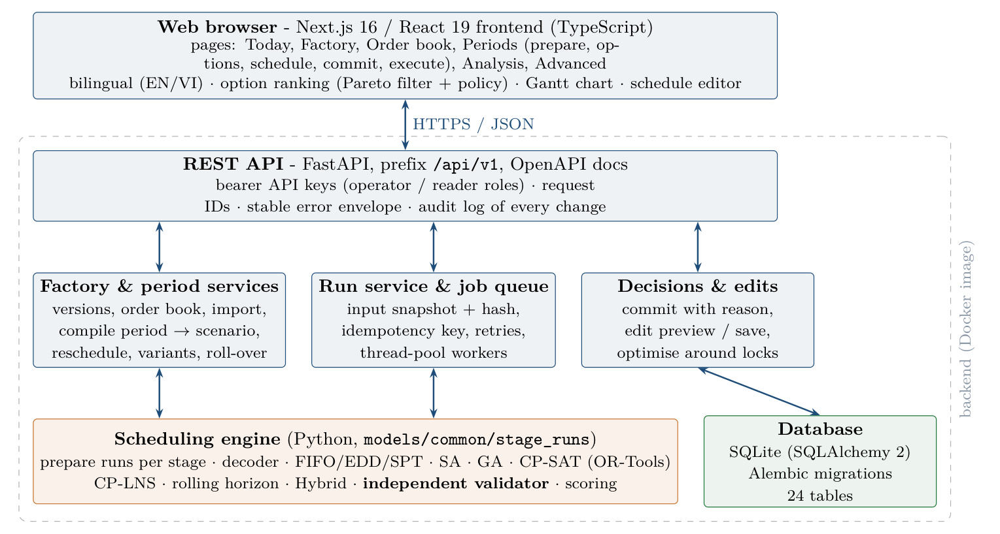

Figure 5 shows the main interaction, generating options. The API stores each run with its input snapshot before solving, returns at once and lets the frontend poll for progress, so that long solver runs never block the interface and every run can be reproduced later.

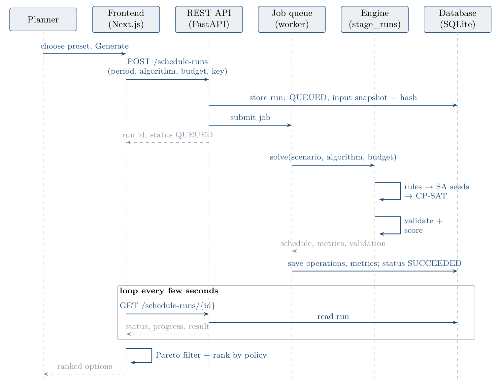

### 4.8.6. Data design

The database has 24 tables. Figure 6 shows the core tables of the planning workflow; Appendix B describes them field by field. A row of `planning_periods` pins the factory version it was planned with and compiles its inputs into a scenario (`master_datasets` and its child tables); solver runs, their operations and the decisions that commit them refer to that scenario. Variants and reschedules point to their parent period.

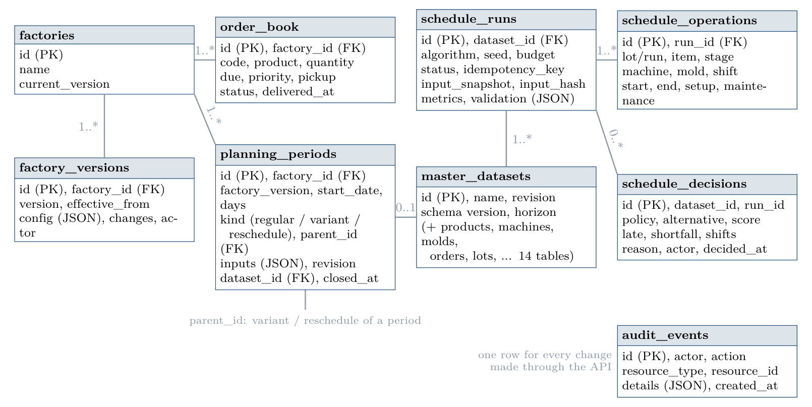

### 4.8.7. API design

The REST API has 60 endpoints under the prefix `/api/v1`, documented automatically with OpenAPI. Table 16 lists the main groups.

Table: Main groups of API endpoints

| Group | Endpoints (examples) | Purpose |
|---|---|---|
| Factories | GET/POST /factories; PUT /factories/{id}/config; GET /factories/{id}/versions/{v}; GET /factories/{id}/outlook | Plant set-up and its versions; weekly load outlook |
| Order book | GET/POST /factories/{id}/orders; PUT/DELETE /factories/{id}/orders/{code}; POST /factories/{id}/orders/import | Orders and Excel/CSV import (preview, then commit) |
| Periods | GET/POST /periods; PUT /periods/{id}/inputs; POST /periods/{id}/book-sync, /variants, /reschedule, /close, /rollover; GET /periods/{id}/state | Period life cycle |
| Schedule runs | POST /schedule-runs; GET /schedule-runs/{id}; POST /schedule-runs/{id}/retry | Run an algorithm on a scenario, follow progress, retry |
| Hand edits | POST /schedule-runs/{id}/edits/preview, /edits, /edits/optimize | Preview an edit, save it as an option, optimise around locked runs |
| Decisions | GET/POST /master-data/datasets/{id}/decisions | Commit a schedule with a reason; read the decision log |
| Planning and data | /production-plans; /master-data/datasets/... | Aggregate plans; scenario data (Advanced pages) |
| System | GET /health; GET /audit-events | Health check; audit trail |

Errors use one stable envelope with a code, a message and the request ID, so that the frontend and other clients can react to them reliably.

### 4.8.8. User interface

The interface is organised around the planner's day. Figure 7 shows the **Today** page, which summarises what needs attention. The factory set-up is edited in tabs and saved as versions (Figure 8); the order book shows the expected load and imports orders with a preview (Figure 9).

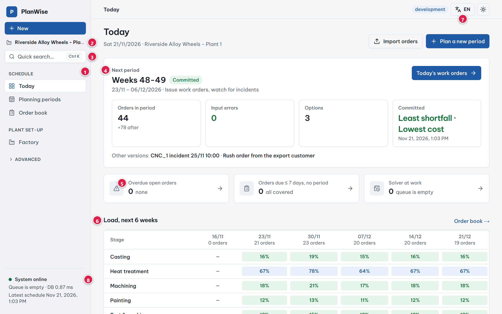

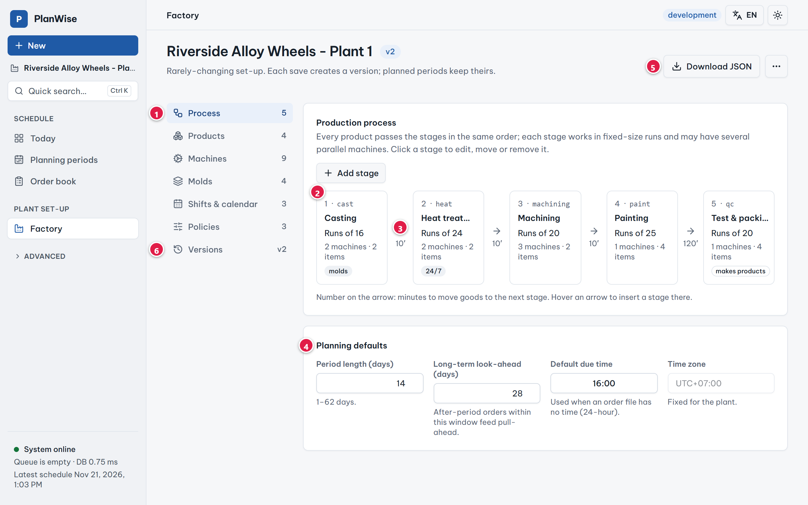

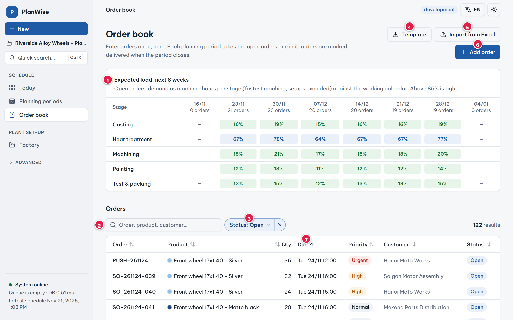

Inside a period, the planner checks the inputs and the estimated stage load (Figure 10), generates options with a preset (Figure 11) and compares the ranked options (Figure 12). The schedule tab shows the key figures and the Gantt chart (Figure 13), and a second option can be compared change by change (Figure 14).

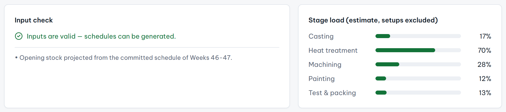

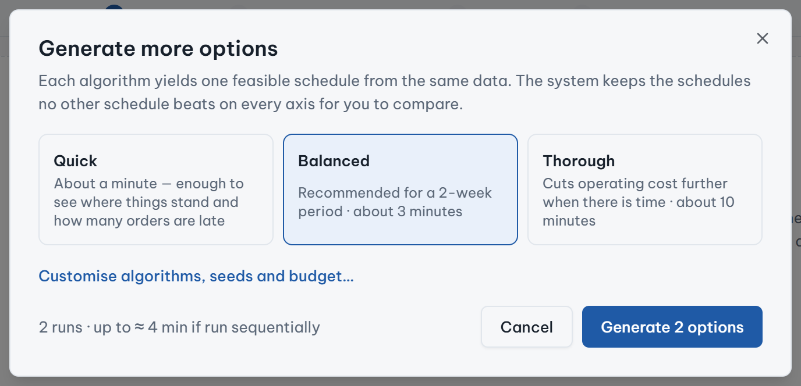

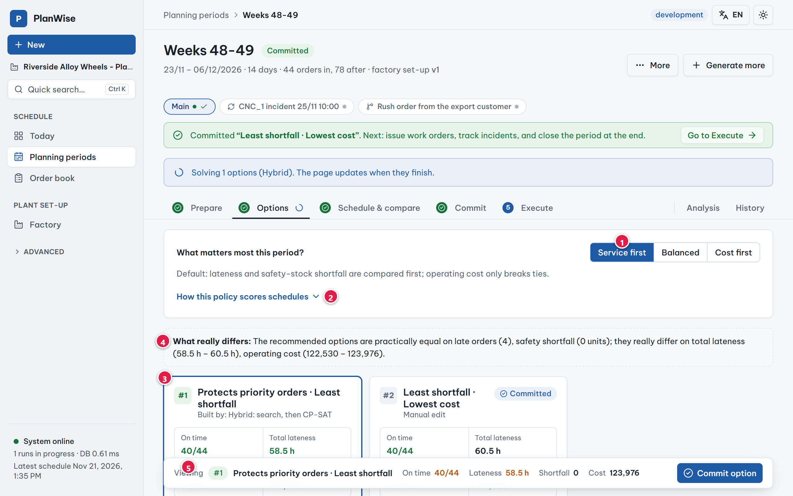

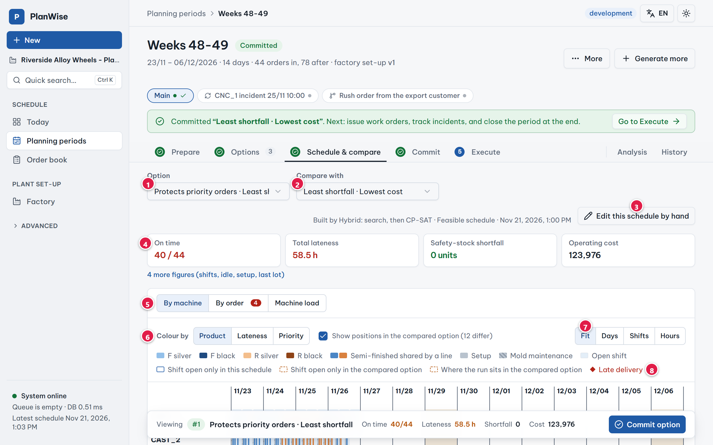

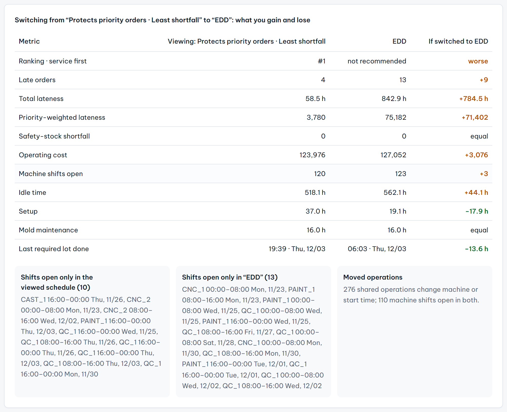

The planner can edit a schedule by hand: every change is rebuilt with the same scheduling rules, validated and scored live against the original (Figure 15). Committing requires a reason and adds the decision to the log (Figure 16); the committed schedule becomes work orders per day and machine (Figure 17). After an incident, the planner picks a cut-off and replans the rest of the period, and at the end closes the period (Figure 18).

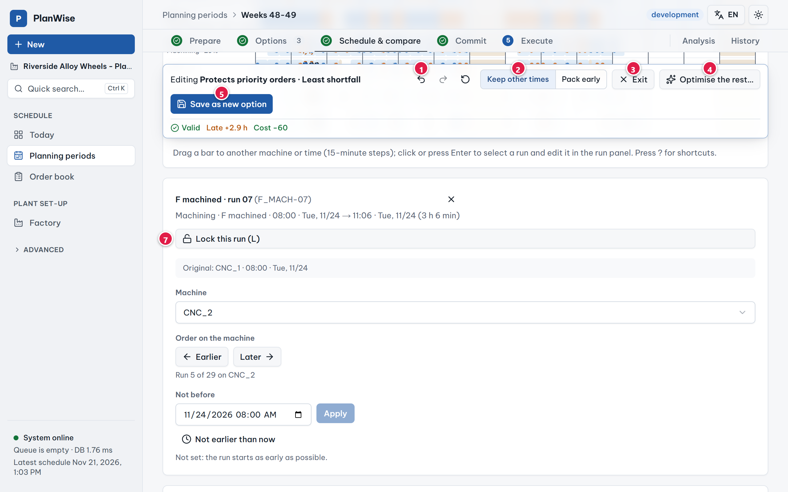

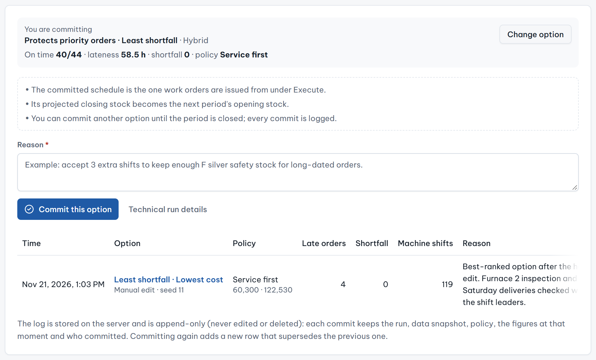

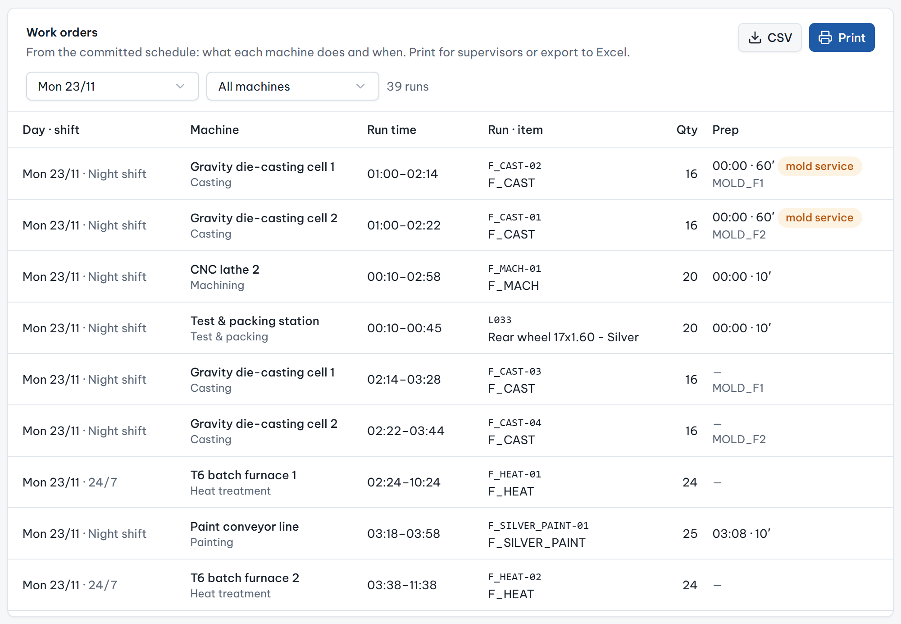

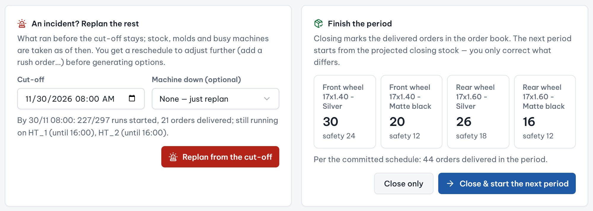

### 4.8.9. The explanation layer

The product provides several forms of explanation, all supporting trust in a schedule rather than being goals in themselves: the **trade-off curve** between options and the sentence "what really differs"; the **comparison of two schedules** metric by metric, shift by shift, with moved runs; **why an order is late** - the longest wait at a stage and its cause (the machine was busy with named runs, part of the wait fell outside open shifts, shifts stayed closed), the bottleneck the order competes for, later orders that went first, or a release too late for the processing time - with the stage-by-stage supply chain of the order (Figure 19); and the **score by component** of every schedule with the best score found over time by each algorithm. Critical-path analysis, sensitivity analysis and counterfactual explanations remain planned work.

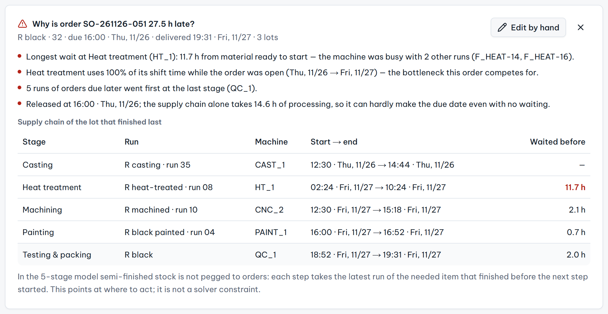

## 4.9. Summary

The solution combines dispatching rules, multi-seed simulated annealing and warm-started CP-SAT in one method, validates every schedule independently and lets the planner choose among non-dominated options under an explicit policy. It is delivered as a three-tier web information system whose data model follows how often information changes, with a period life cycle that covers preparation, decision, execution and rescheduling.

# 5. Testing, evaluation and deployment

This chapter verifies that the system works as specified and evaluates how good its schedules are. It covers unit and system testing, the experimental evaluation of the scheduling methods, deployment, and the assessment against the success criteria.

## 5.1. Unit testing

Automated tests are written with pytest for the engine and the backend and run by continuous integration on every push and pull request, together with linting, type checking and a production build of the frontend. Table 17 lists the test suites; all 130 tests pass.

Table: Automated test suites

| Test file | Tests | What is checked |
|---|---:|---|
| models/tests/test_stage_runs.py | 23 | Five-stage engine: every method valid, tier 1 dominates, solver objective equals the evaluator, fixed runs kept; deliberately broken schedules rejected (machine overlap, wrong setup, free mold change, missing maintenance, WIP shortfall, run across a break, one mold on two machines) |
| models/tests/test_contract.py | 21 | Four-stage engine and shared rules: stock events, transfer lags, shared semi-finished pools, baselines valid, validator detects missing operations, overlaps, setups, maintenance and shortfalls |
| models/tests/test_reserve_capacity.py | 17 | Build-ahead options: idle shifts used before new shifts are opened, caps by long-dated demand, unchosen options cost nothing, invalid options rejected |
| models/tests/test_stage_runs_speed.py | 11 | Faster decoder gives identical schedules; every CP-SAT variable hinted; Hybrid never worse than the best rule; multi-seed SA relay |
| models/tests/test_manual_edits.py | 8 | Hand edits: unedited plan rebuilds the same schedule, moves stay valid, explicit error codes, locked runs kept and the rest never worse |
| backend/tests/test_api.py | 32 | API: health, API-key roles, audit events, idempotency, retries, error envelope, runs persisted and validated, decisions require a reason, Hybrid chain, hand-edit preview/save/optimise |
| backend/tests/test_factories.py | 11 | Factory model: bootstrap, recompilation, order import (CSV and Excel), commit, reschedule, variant and roll-over, factory versions and effective dates |
| backend/tests/test_schema.py | 7 | Input contract: unknown products and fields, order timing, orders outside the horizon, legacy data relabelled explicitly |

## 5.2. System testing

### 5.2.1. Functional testing

The functional test cases of Table 18 were executed on the demonstration plant with the English interface on 21/11/2026: mostly through the web interface while recording the demo video and the screenshots of the user guide, and partly through the API while building the demonstration data (TC-01, TC-03).

Table: Functional test cases

| ID | Test case | Expected result | Status |
|---|---|---|---|
| TC-01 | Save a new factory version with a machine effective from a future date | New version listed; periods starting after that date use it | Pass |
| TC-02 | Import orders from a file with new, updated and invalid rows | Preview classifies each row; only valid rows are saved | Pass |
| TC-03 | Roll over a committed and closed period into the next one | Opening stock of the new period equals the closing stock of the previous one | Pass |
| TC-04 | Generate options with the Balanced preset | Runs finish with validated schedules; options ranked under the policy | Pass |
| TC-05 | Switch the ranking policy | Options re-ranked instantly without solving again | Pass |
| TC-06 | Compare the recommended option with the EDD schedule | Differences shown metric by metric, with moved runs | Pass |
| TC-07 | Open the explanation of a late order | Cause and supply chain of the order displayed | Pass |
| TC-08 | Move a run by hand, then optimise the rest | Edit validated live; optimised result never worse than the edit; saved as a new option | Pass |
| TC-09 | Commit an option without and with a reason | Commit refused without a reason; with a reason the decision appears in the log | Pass |
| TC-10 | Print the work orders of a day | Sheet per machine with runs in time order | Pass |
| TC-11 | Reschedule from a cut-off after a breakdown | Runs before the cut-off frozen; a reschedule version is created and can be generated and committed | Pass |
| TC-12 | Close the period | Deliveries recorded; period closed and locked against edits | Pass |

### 5.2.2. Validity of generated schedules

Across all experiments, every exported schedule passed the independent validator (16/16 schedules exported in the long runs of Section 5.3, 18/18 on the three-day dataset). Runs that ended without a schedule - such as monolithic CP-SAT on the two-week dataset - are reported as such and never replaced by a placeholder.

## 5.3. Evaluation of the scheduling methods

### 5.3.1. Experimental set-up

Unless stated otherwise, algorithms run one after another on the same computer with the same time budget and one CP-SAT thread; randomised algorithms run three seeds (11, 29, 47). Every run stores its input, configuration, schedule and log for reproducibility. Scores are written **tier 1 · tier 2**; lower is better, tier 1 first.

### 5.3.2. Results on the three-day dataset

Table: Single algorithms on the three-day dataset (30 s per run, 18/18 runs valid)

| Algorithm | Best schedule (3 seeds) | Safety shortfall (wheels) | Machine-shifts |
|---|---:|---:|---:|
| CP-LNS | 40 · 10,564 | 2 | 11 |
| SA | 40 · 14,397 | 2 | 13 |
| GA | 40 · 15,843 | 2 | 14 |
| CP-SAT warm-started from EDD | 120 · 11,440 | 6 | 10 |
| FIFO | 160 · 17,938 | 8 | 15 |
| EDD / SPT | 200 · 17,904 | 10 | 15 |
| Monolithic CP-SAT | 8,410 · 24,067 (1 late order) | 2 | 19 |
| Hand-made schedule | 160 · 6,356 | 8 | 7 |

Table: Combined solution on the three-day dataset (step S3: warm-started CP-SAT, ε-constraints, 60 s, 8 threads)

| Proposed option | Built by | Score | Safety shortfall | Machine-shifts | Versus the best single-algorithm schedule |
|---|---|---:|---:|---:|---|
| **Best stock** | CP-SAT, ε ≤ 2 | **40 · 9,034** | 2 | 10 | Same service as CP-LNS, operating cost 14% lower, one machine-shift fewer |
| Middle | CP-SAT, ε ≤ 4 | 80 · 8,310 | 4 | 10 | Trades 2 wheels of safety stock for 8% lower cost |
| **Cheapest** | CP-SAT, ε ≤ 8 | **160 · 6,110** | 8 | 7 | Same service and shifts as the hand-made schedule, operating cost 4% lower |

Of the 13 schedules generated, the 3 non-dominated ones all come from step S3; **no single algorithm produced a non-dominated schedule**, not even the hand-made one. Figure 20 shows the clear choice the planner faces: cutting the safety shortfall from 8 to 2 wheels requires 3 more machine-shifts and about 48% more operating cost. Step S3 used 60 s and 8 threads, unlike the single algorithms (30 s, 1 thread), so the comparison is between the **combined solution** and **its components**, not a fair comparison of algorithms. No option is proven optimal; ε ≤ 2 is the lowest value tried, not proven to be the lowest possible.

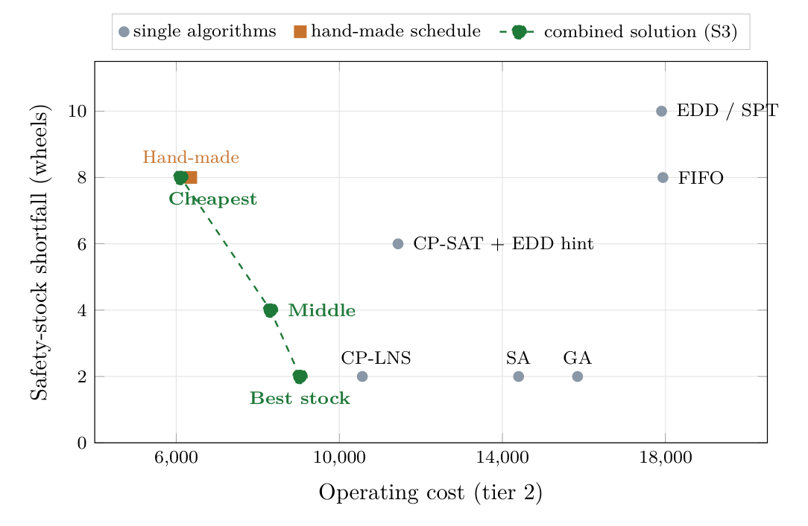

### 5.3.3. Results on the two-week dataset

With a fixed budget of 120 s (progress report of 03/10/2026), the best schedule (SA) still had one late order, CP-based methods could not improve the EDD schedule and monolithic CP-SAT found nothing. The algorithms were therefore run **until they stopped improving**: SA, GA and CP-LNS on one thread, stopping after 600 s without improvement (safety limit 2 hours, three seeds); rolling-horizon CP-SAT with 4-day windows, a 2-day step and at most 60 runs per window; CP-SAT warm-started from the best schedule (SA, seed 29) on 8 threads until optimality or 24 hours; and monolithic CP-SAT without a start schedule on 8 threads until optimality or 12 hours.

Table: Results on the two-week dataset, run until convergence

| Method | Valid | Late orders | Safety shortfall (wheels) | Best score | Machine-shifts | Utilisation | Time |
|---|---:|---:|---:|---:|---:|---:|---:|
| **CP-SAT warm-started from SA** | 1/1 | **0** | 8 | **160 · 35,016** | **46** | **73.6%** | 24 h |
| SA | 3/3 | 0 (all 3 seeds) | 8 | 160 · 73,495 | 73 | 47.3% | 1.2-1.8 h |
| GA | 3/3 | 0 (1 of 3 seeds) | 8 | 160 · 84,140 | 80 | 42.8% | 0.5-1.3 h |
| Rolling-horizon CP-SAT | 3/3 | 2 | 20 | 88,960 · 56,528 | 60 | 56.4% | 1.7 h |
| EDD | 1/1 | 5 | 28 | 323,465 · 104,894 | 95 | 35.9% | < 1 s |
| CP-LNS | 3/3 | 5 | 28 | 323,465 · 101,816 | 93 | 37.0% | 10-15 min |
| FIFO | 1/1 | 5 | 14 | 365,305 · 105,032 | 95 | 35.8% | < 1 s |
| SPT | 1/1 | 5 | 8 | 389,245 · 104,822 | 95 | 35.9% | < 1 s |
| Monolithic CP-SAT | 0/1 | - | - | No schedule found | - | - | 12 h |

- **No late orders.** Run to convergence, all three SA seeds reach 0 late orders (with 120 s: one late order); GA reaches it with one of three seeds. The earlier result was mostly limited by running time.
- **Rolling horizon is an intermediate solution:** tier 1 is 72% lower than EDD and fewer shifts are opened than with SA, but two orders are still late, probably because a 4-day window cannot see the due dates of later windows.
- **CP-LNS does not improve the EDD schedule** for any seed: each LNS round still builds the full model, so the sub-problem is not really smaller.
- **Monolithic CP-SAT is unusable at this scale:** no solution after 12 hours on 8 threads, while the same solver given a start schedule improves after 37 s.

### 5.3.4. CP-SAT warm-started from the SA schedule

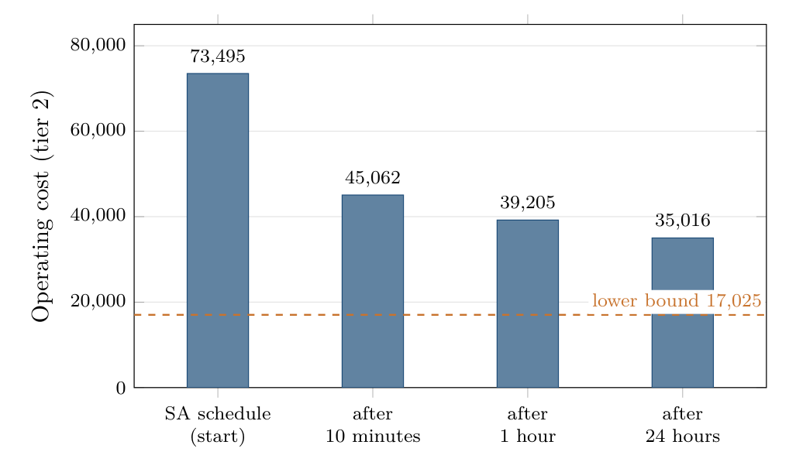

- **The service level is proven optimal.** The lower bound found by CP-SAT (160,017,025) shows that no schedule has tier 1 below 160: with the current data and weights, **zero late orders and a safety shortfall below 8 wheels cannot both be achieved**. This is the project's first proven optimality result on a two-week instance.
- **Operating cost falls sharply** (Figure 21). From the SA schedule (73,495), CP-SAT reaches 45,062 after 10 minutes, 39,205 after 1 hour and 35,016 after 24 hours (−52%). Machine-shifts drop from 73 to 46 and utilisation in opened shifts rises from 47% to 74%. Tier 2 is not proven optimal: the bound is 17,025, a gap of about 51%.
- 24 hours only probes the limit; for a planner, 10 minutes (tier 2 already −39%) is the practical point. CP-SAT used 8 threads and 24 hours while the other algorithms used one thread, so this again compares the combined solution with its components.

These results **confirm the structure of the combined solution**: SA finds good schedules at scale, and CP-SAT warm-started from them cuts cost and proves a bound. On the two-week dataset this step dominates every single algorithm.

### 5.3.5. The Hybrid method in the product

The Hybrid method automates the chain within minutes. Table 22 reports runs on the two-week dataset with 8 cores / 16 threads (one run per line; not yet repeated enough for averages).

Table: The Hybrid method on the two-week dataset

| Run | Late orders | Score | Machine-shifts | Utilisation |
|---|---:|---:|---:|---:|
| Whole pipeline, 60 s (seeds 11, 29) | **0** | 160 · 98,567 and 160 · 100,566 | 91 | - |
| Whole pipeline, 180 s (seeds 11, 29, 47) | **0** | 160 · 55,078 - 59,074 | 60-64 | 56-57% |
| Whole pipeline, 540 s (seed 11) | **0** | 160 · 44,729 | 53 | 64.9% |
| CP-SAT + EDD hint, 180 s (previous product default) | 5 | EDD schedule kept | 95 | 35.9% |

- In every run the CP-SAT bound is at least 160,003,000: **tier 1 = 160 is proven optimal** within minutes instead of hours.
- With 60 s the budget is thin (SA gets only 24 s): one run through the backend while the web server was busy still reached 0 late orders (160 · 105,436), but only one of eight SA seeds did; with 180 s all eight seeds reached tier 1 = 160. This is why 180 s ("Balanced") is the recommended preset for two-week periods.
- Hybrid uses every core, so its scores are a "whole machine" result and not a fair one-thread comparison of algorithms.

### 5.3.6. Effect of the machine-utilisation objective

Running Hybrid for 180 s with the weight of non-productive time set to 0 (other weights unchanged) gives 85-89 opened shifts and 38-40% utilisation, against 59-64 shifts and 56-58% with the default weight - in both cases with 0 late orders. The objective thus saves about 25-30 machine-shifts and raises utilisation by about 18 percentage points; in exchange, finished goods stay longer in stock (surplus stock about 2,360 instead of 1,400). The original target of 90% utilisation is not reached: the best measured values are 64.9% after 9 minutes and 73.6% after 24 hours, because the line's minimum load is low - even heat treatment, the bottleneck, needs only 56-65% of its time on the two-week dataset.

## 5.4. Deployment

The system can be run in three ways:

- **Local development:** one PowerShell script (`scripts/dev.ps1`) starts the backend and the frontend together; the database is created and migrated automatically, and a sample factory is bootstrapped when it is empty.
- **Docker Compose:** `compose.yaml` builds images for the backend and the frontend; research code, run records and documents are excluded from the images.
- **Public demo on Render:** a Render Blueprint (`render.yaml`) creates the two services from the Git repository and redeploys them automatically on every push to the `master` branch (Table 23).

Table: Public demonstration deployment

| Item | Value |
|---|---|
| Web application | https://mnft-frontend.onrender.com |
| REST API (health check) | https://mnft-backend.onrender.com/api/v1/health |
| Source code | https://github.com/vandungvo/mnft-schdl |
| Hosting | Render, free plan, Singapore region; two Docker services (Next.js frontend, FastAPI backend) |
| Data | The English demonstration plant "Riverside Alloy Wheels - Plant 1": 156 orders, period "Weeks 46-47" committed and closed, period "Weeks 48-49" ready to plan |
| Interface language | English by default; Vietnamese available from the language menu |

The free plan has no persistent disk: the database is recreated on every deploy, restart or wake-up after 15 minutes of inactivity. The backend therefore ships a snapshot of the demonstration plant and copies it into place whenever it starts without a database, then runs the migrations; visitors can try every feature, and the demonstration returns to its initial state after the next restart. Solver runs are capped at 120 seconds and the instance has a small share of one CPU, so schedules are weaker than on a workstation (on the 2-week sample period, Hybrid with the Quick preset reached 22 of 24 orders on time instead of 24); the first visit after a pause takes about a minute while the services wake up.

Continuous integration (GitHub Actions) runs the backend and engine tests, a notebook test, and the frontend lint, type check and build on every push and pull request. The deployment is at prototype level: it has not been installed in a real plant, and the hosted demo is meant for review rather than production use.

## 5.5. Evaluation against the success criteria

Table: Evaluation against the success criteria of the preliminary report

| Criterion | Result |
|---|---|
| 100% valid schedules | **Met**: every exported schedule passes the independent validator; runs without a schedule are reported, never faked |
| No late orders on the two-week dataset | **Met** (SA, GA, warm-started CP-SAT; the product's Hybrid at 60, 180 and 540 s) |
| Proven solution quality | **Partly met**: tier 1 proven optimal on the two-week dataset (within minutes with Hybrid); tier 2 still 51% from the bound |
| Machine utilisation ≥ 90% in opened shifts | **Not met**: from 28-52% to **64.9%** in 9 minutes and **73.6%** after 24 hours; the criterion should be redefined, for example on the bottleneck stage |
| The planner chooses, edits and commits | **Met**: planning desk in the product, hand edits and "optimise the rest", decisions stored with an audit log |
| Acceptable solving time, warning when not optimal | **Met**: three-day dataset in seconds to 60 s; two-week dataset with 0 late orders in about 1 minute, 3 minutes recommended; the solver status is always shown |
| Reaction to disruptions | **Met**: replanning from a cut-off after a breakdown or rush order; what-if variants |
| Schedule explanation (supporting) | **Partly met**: trade-off curve, two-schedule comparison, why an order is late, score by component; critical path and sensitivity not yet |
| Quality on public benchmarks | **Not evaluated yet** |

## 5.6. Response to the supervisor's requests

Table: Response to the supervisor's four requests

| # | Request | Status | Result | Section |
|---|---|---|---|---|
| 1 | Add benchmark data (data.gov, data.gov.vn, Kaggle…) | Mostly done | 4 public datasets + 2 self-built datasets + a demonstration plant; 3 open-data portals searched, no suitable dataset yet | 3.5, 4.2 |
| 2 | Add references, especially recent ones | Done | From 19 to **32 references**; **16 published in 2024-2026**; 2 Vietnamese works added | 2, 3 |
| 3 | Build a comparison table | Done | 17-row literature table and a comparison with related software | 3.2, 3.4 |
| 4 | Implement and evaluate the model | Done (exploratory) | 10 scheduling methods + independent validator, evaluated on 2 datasets, delivered in a working information system | 4, 5 |

## 5.7. Summary

All 130 automated tests and the 12 functional test cases pass, and every schedule shown by the system is independently validated. The experiments confirm the design: no single algorithm is best on both datasets, the combined solution dominates its components, and the product's Hybrid method reaches the proven-optimal service level of the two-week dataset within minutes while opening far fewer machine-shifts than the dispatching rules.

# 6. Conclusion

## 6.1. Results achieved

Over the semester the project achieved the following:

- A **scheduling model** of a five-stage wheel line as an extended FJSP, with shifts, shared molds and their maintenance, sequence-dependent setups, stage lots, WIP buffers, safety stock, warehouse caps, deliveries and build-ahead options.
- A **combined scheduling solution** - ten methods, a Hybrid production method (rules → multi-seed SA → warm-started CP-SAT), an independent validator, a Pareto filter and policy-based ranking - evaluated on two business datasets. On the two-week dataset it reaches zero late orders in about a minute and proves the service level optimal within minutes.
- A working **management information system** with a versioned factory set-up, an order book with Excel import, planning periods, option comparison, hand editing with "optimise the rest", commitment with a reason and an audit trail, work orders, rescheduling after incidents, what-if variants and explanations of late orders.
- **Documentation and evidence:** a literature review with 32 references, a survey of benchmark data, reproducible experiment records, 130 automated tests, a 91-page user guide and a narrated demo video.
- **A public demonstration** at https://mnft-frontend.onrender.com with the English sample plant, deployed automatically from the source repository https://github.com/vandungvo/mnft-schdl.

## 6.2. Contributions

- **For management:** schedules become decisions made on explicit grounds - the trade-off between service and cost is visible, every decision carries its reason, and every change is traceable.
- **For operations:** fewer opened machine-shifts for the same service (53 instead of 95 on the two-week dataset after nine minutes), and a structured way to react to incidents without rebuilding the plan by hand.
- **For research and teaching:** evidence that combining algorithms, rather than choosing one, is the robust approach for this class of problem, together with datasets and records that others can reuse.

## 6.3. Limitations

- Each size has a single synthetic dataset, the long CP-SAT runs ran once, and each Hybrid configuration two to four times: the experiments are **exploratory**, not yet statistical conclusions.
- The data is synthetic and the objective weights are policy assumptions, not converted from real costs. Seven weight variants were tried on the three-day dataset and the top rank did not change.
- Rescheduling is triggered by the planner; the system does not read live shop-floor data.
- CP-LNS and rolling-horizon CP-SAT remain weak at 269 runs, and Hybrid results use all processor cores.
- The public benchmarks (Taillard, Lawrence, Deliktaş) are downloaded but not yet run; critical-path and sensitivity analysis are not implemented.

## 6.4. Future work

1. Run the CP-SAT core and the dispatching rules on Taillard and Lawrence and report the relative percentage deviation (RPD) from the best known solutions.
2. Repeat the Hybrid runs on several seeds and machines to obtain confidence intervals.
3. Make CP-LNS build only the reopened runs, and add a look-ahead penalty to rolling-horizon CP-SAT for orders due in later windows.
4. Redefine the utilisation criterion on the bottleneck stage; implement critical-path and sensitivity analysis.
5. Download and inspect the Kaggle candidates and browse data.gov.vn directly, recording why each dataset is kept or rejected; calibrate the parameters with data from a real plant.
6. Connect the system to shop-floor data (MES) so that incidents trigger rescheduling automatically.

# References

1. Taillard, E. (1993). Benchmarks for basic scheduling problems. *European Journal of Operational Research*, 64(2), 278-285.
2. Lawrence, S. (1984). *Resource constrained project scheduling: An experimental investigation of heuristic scheduling techniques*. GSIA, Carnegie Mellon University.
3. Beasley, J. E. (1990). OR-Library: Distributing test problems by electronic mail. *Journal of the Operational Research Society*, 41(11), 1069-1072.
4. Google OR-Tools - CP-SAT Solver. https://developers.google.com/optimization/cp/cp_solver
5. Wang, Y. C., & Chen, T. (2024). Adapted techniques of explainable artificial intelligence for explaining genetic algorithms on the example of job scheduling. *Expert Systems with Applications*, 237, 121369. https://doi.org/10.1016/j.eswa.2023.121369
6. Wang, Y. C., & Chen, T. (2025). *Explainable and Customizable Job Sequencing and Scheduling: Advancing Production Control and Management with XAI*. Springer. https://doi.org/10.1007/978-3-031-85374-6
7. Mehdiyev, N., Majlatow, M., & Fettke, P. (2024). Counterfactual Explanations in the Big Picture: An Approach for Process Prediction-Driven Job-Shop Scheduling Optimization. *Cognitive Computation*, 16, 2674-2700. https://doi.org/10.1007/s12559-024-10294-0
8. Cheng, Y., Xie, Z., Xin, Y., Chen, K., & Zarei, R. (2024). Flexible Job Shop Scheduling Method for Optimizing Mold Resource Setup Time. *IEEE Access*, 12, 33486-33503. https://doi.org/10.1109/ACCESS.2024.3372396
9. Lan, L., & Berkhout, J. (2025). PyJobShop: Solving scheduling problems with constraint programming in Python. *arXiv:2502.13483*. https://arxiv.org/abs/2502.13483
10. Deliktaş, D., Özcan, E., Üstün, Ö., & Torkul, O. (2024). A benchmark dataset for multi-objective flexible job shop cell scheduling. *Data in Brief*, 52, 109946. https://doi.org/10.1016/j.dib.2023.109946 (dataset: https://data.mendeley.com/datasets/rtzby7pv7m/1)
11. Mota, B., Gomes, L., Faria, P., Ramos, C., & Vale, Z. (2020). Production line dataset for task scheduling and energy optimization - Schedule Optimization (v0.1) [Dataset]. Zenodo. https://doi.org/10.5281/zenodo.4106746
12. Dauzère-Pérès, S., Ding, J., Shen, L., & Tamssaouet, K. (2024). The flexible job shop scheduling problem: A review. *European Journal of Operational Research*, 314(2), 409-432. https://doi.org/10.1016/j.ejor.2023.05.017
13. Li, S., Ouyang, W., Ma, Y., & Wu, C. (2025). Learning-Guided Rolling Horizon Optimization for Long-Horizon Flexible Job-Shop Scheduling. In *International Conference on Learning Representations (ICLR 2025)*. https://openreview.net/forum?id=Aly68Y5Es0
14. Kelley, J. E., & Walker, M. R. (1959). Critical-path planning and scheduling. In *Papers presented at the December 1-3, 1959, eastern joint IRE-AIEE-ACM computer conference*, ACM Press, 160-173. https://doi.org/10.1145/1460299.1460318
15. Nedbálek, L., & Novák, A. (2025). Bottleneck Identification in Resource-Constrained Project Scheduling via Constraint Relaxation. In *Proceedings of the 14th International Conference on Operations Research and Enterprise Systems (ICORES 2025)*, 340-347. https://doi.org/10.5220/0013253700003893
16. Hax, A. C., & Meal, H. C. (1975). Hierarchical integration of production planning and scheduling. In M. A. Geisler (Ed.), *Studies in Management Sciences, Vol. 1: Logistics* (pp. 53-69). North-Holland/American Elsevier.
17. De Bock, K. W., Coussement, K., De Caigny, A., Słowiński, R., Baesens, B., Boute, R. N., Choi, T. M., Delen, D., Kraus, M., Lessmann, S., Maldonado, S., Martens, D., Óskarsdóttir, M., Vairetti, C., Verbeke, W., & Weber, R. (2024). Explainable AI for Operational Research: A defining framework, methods, applications, and a research agenda. *European Journal of Operational Research*, 317(2), 249-272. https://doi.org/10.1016/j.ejor.2023.09.026
18. Garn, W., & Amirghasemi, M. (2025). Transparency of combinatorial optimisations via machine learning and explainable AI. *Annals of Operations Research*, 354, 427-458. https://doi.org/10.1007/s10479-025-06684-8
19. Trang, H. S. (2021). *Một số phương pháp tiếp cận cho bài toán lập lịch cá nhân* [Some approaches to the personal scheduling problem] [Doctoral dissertation]. Ho Chi Minh City University of Technology - VNU-HCM. https://grad.hcmut.edu.vn/hv/download/LATS/8140009/TOM_TAT_LATS_THSon.pdf
20. Ghaleb, M., Taghipour, S., & Zolfagharinia, H. (2021). Real-time integrated production-scheduling and maintenance-planning in a flexible job shop with machine deterioration and condition-based maintenance. *Journal of Manufacturing Systems*, 61, 423-449. https://doi.org/10.1016/j.jmsy.2021.09.018
21. Ruiz, R., & Vázquez-Rodríguez, J. A. (2010). The hybrid flow shop scheduling problem. *European Journal of Operational Research*, 205(1), 1-18. https://doi.org/10.1016/j.ejor.2009.09.024
22. Allahverdi, A. (2015). The third comprehensive survey on scheduling problems with setup times/costs. *European Journal of Operational Research*, 246(2), 345-378. https://doi.org/10.1016/j.ejor.2015.04.004
23. Zhang, C., Song, W., Cao, Z., Zhang, J., Tan, P. S., & Xu, C. (2020). Learning to Dispatch for Job Shop Scheduling via Deep Reinforcement Learning. *Advances in Neural Information Processing Systems*, 33.
24. Song, W., Chen, X., Li, Q., & Cao, Z. (2023). Flexible Job-Shop Scheduling via Graph Neural Network and Deep Reinforcement Learning. *IEEE Transactions on Industrial Informatics*, 19(2), 1600-1610. https://doi.org/10.1109/TII.2022.3189725
25. Smit, I. G., Zhou, J., Reijnen, R., Wu, Y., Chen, J., Zhang, C., Bukhsh, Z., Zhang, Y., & Nuijten, W. P. M. (2025). Graph neural networks for job shop scheduling problems: A survey. *Computers & Operations Research*, 176, 106914. https://doi.org/10.1016/j.cor.2024.106914
26. Echeverria, I., Murua, M., & Santana, R. (2025). Leveraging constraint programming in a deep learning approach for dynamically solving the flexible job-shop scheduling problem. *Expert Systems with Applications*, 265, 125895. https://doi.org/10.1016/j.eswa.2024.125895
27. Hu, C., Zhang, Y., & Baier, H. (2026). Scheduling That Speaks: An Interpretable Programmatic Reinforcement Learning Framework. *arXiv:2605.18454* (preprint). https://arxiv.org/abs/2605.18454
28. Liu, A., Lin, S., Chen, J., Wu, P., & Shen, Z. M. (2026). Machine Learning for Scheduling Decision Systems: A Critical Review of Architecture, Assurance, and Deployment. *arXiv:2512.22642v3* (preprint). https://arxiv.org/abs/2512.22642v3
29. Nguyễn Hồng Phúc, Lê Thị Thanh Hương, Nguyễn Thúy Vi, & Tiền Tú Trinh (2026). Mô hình tối ưu điều độ job-shop linh hoạt kết hợp hoạch định nguồn lực thuê ngoài [An optimisation model for flexible job-shop scheduling combined with outsourcing resource planning]. *TNU Journal of Science and Technology*, 231(02), 204-212. https://doi.org/10.34238/tnu-jst.14459
30. Nguyễn Hữu Mùi & Vũ Đình Hòa (2012). Một thuật toán di truyền hiệu quả cho bài toán lập lịch Job Shop [An efficient genetic algorithm for the job shop scheduling problem]. *Tạp chí Khoa học và Công nghệ* [Journal of Science and Technology], 50, 565-577. https://vjs.ac.vn/jst/article/view/9529
31. Vieira, G. E., Herrmann, J. W., & Lin, E. (2003). Rescheduling Manufacturing Systems: A Framework of Strategies, Policies, and Methods. *Journal of Scheduling*, 6, 39-62. https://doi.org/10.1023/A:1022235519958
32. Chalumeau, F., Coulon, I., Cappart, Q., & Rousseau, L.-M. (2021). SeaPearl: A Constraint Programming Solver guided by Reinforcement Learning. *arXiv:2102.09193*. https://arxiv.org/abs/2102.09193

# Appendix A. Detailed use cases

Table: Use case UC-04 Generate schedule options

| Item | Description |
|---|---|
| Use-case name | Generate schedule options |
| Description | Run one or more scheduling algorithms on the compiled scenario of a planning period and obtain validated schedule options |
| Actor | Planner (operator role) |
| Trigger | The planner clicks Generate on the Options tab of a period |
| Preconditions | The period is open and its inputs compile without blocking issues; the scenario is up to date with the inputs |
| Normal flow | 1. The planner opens the Generate dialog. 2. The planner chooses a preset (Quick, Balanced, Thorough) or a custom set of algorithms and budgets. 3. The system creates one run per algorithm, stores its input snapshot and returns at once. 4. Background workers solve the runs; the dialog shows progress. 5. Each finished schedule is validated and scored. 6. The Options tab shows the non-dominated options ranked under the period's policy |
| Postconditions | New runs are stored with their status, schedule, metrics and validation result; the options list is updated |
| Alternative flows | 2a. The planner reruns a failed run with Retry; the run keeps its original snapshot and records its lineage |
| Exception flows | 4a. An algorithm finds no schedule within its budget: the run ends without a schedule, with the solver status, and no option is added. 5a. A schedule fails validation: it is reported as invalid and never offered as an option |

Table: Use case UC-06 Edit a schedule by hand and optimise the rest

| Item | Description |
|---|---|
| Use-case name | Edit a schedule by hand and optimise the rest |
| Description | Change a schedule manually, see the impact live, and let CP-SAT re-optimise the runs that are not locked |
| Actor | Planner (operator role) |
| Trigger | The planner clicks Edit by hand on an option |
| Preconditions | The period is not closed; the option comes from a successful run of the current scenario |
| Normal flow | 1. The editor opens on a copy of the schedule. 2. The planner drags a run or changes its machine, order or earliest start. 3. The system rebuilds the schedule with the same scheduling rules, validates it and shows the impact on late orders, shortfall, cost and shifts. 4. The planner locks the runs to keep and chooses Optimise the rest. 5. CP-SAT re-sequences the unlocked runs in the background; the result is never worse than the edit. 6. The planner saves the result as a new option |
| Postconditions | A new run (manual edit or CP-SAT repair) is stored, validated and ranked with the solver's options |
| Alternative flows | 4a. The planner saves the edit directly without optimising |
| Exception flows | 3a. The edit breaks a constraint (for example a run across a break): the editor shows the issue code and the edit cannot be saved until it is fixed |

Table: Use case UC-07 Commit a schedule

| Item | Description |
|---|---|
| Use-case name | Commit a schedule |
| Description | Record the option chosen for the period, with the policy and the reason, so the decision can be explained later |
| Actor | Planner (operator role) |
| Trigger | The planner clicks Commit on an option |
| Preconditions | The option comes from a successful, validated run of the period's scenario |
| Normal flow | 1. The Commit tab shows the option, its figures and the policy. 2. The planner writes the reason. 3. The system stores the decision with the run, data snapshot, policy, figures and the actor. 4. The period moves to execution and the work orders become available |
| Postconditions | An append-only decision record and an audit event are stored |
| Alternative flows | 1a. The planner commits a different option later; a new decision is appended and the earlier one is kept |
| Exception flows | 2a. The reason is empty: the commit is refused. 3a. The run does not belong to the period's scenario or did not succeed: the commit is refused |

Table: Use case UC-09 Reschedule after an incident

| Item | Description |
|---|---|
| Use-case name | Reschedule after an incident |
| Description | Replan the rest of a committed period from a cut-off time after a machine breakdown or a rush order |
| Actor | Planner (operator role) |
| Trigger | The planner chooses Reschedule from the execution view |
| Preconditions | The period has a committed schedule and is not closed |
| Normal flow | 1. The planner picks the cut-off time and, optionally, the machine that is down and until when. 2. The system fixes the runs that ran before the cut-off and counts runs in progress at the cut-off as done. 3. Stock, mold counters and delivered orders are taken as of the cut-off. 4. A reschedule version of the period is created, linked to its parent. 5. The planner generates, compares and commits options for it as for any period |
| Postconditions | A reschedule period linked to its parent exists; once committed, it replaces the parent's plan from the cut-off |
| Alternative flows | 1a. A rush order is first added to the order book and then taken into the reschedule by synchronising the period with the book |
| Exception flows | 1b. The cut-off does not fall inside the period: the request is refused with an explanation |

# Appendix B. Database design

The database is managed with SQLAlchemy 2 and versioned with Alembic migrations. The tables below describe the core of the planning workflow; the scenario tables (products, semi-finished codes, routings, inventories, machines, capabilities, changeovers, windows, shifts, downtimes, molds, orders, lots, allocations) hold the compiled data of a period and are not repeated here.

Table: Fields of the factories table

| Field | Type | Description |
|---|---|---|
| id | String(36), PK | Identifier of the plant |
| name | String(200) | Name of the plant |
| current_version | Integer | Latest version of its configuration |
| created_at, updated_at | DateTime | Creation and last update time |

Table: Fields of the factory_versions table

| Field | Type | Description |
|---|---|---|
| id | Integer, PK | Identifier |
| factory_id | FK → factories | Plant the version belongs to |
| version | Integer | Version number (unique per plant) |
| effective_from | String(10) | First period start date the version applies to; empty = from the start |
| config | JSON | Complete, immutable plant configuration |
| note, changes | Text, JSON | Note and list of changes from the previous version |
| actor, created_at | String, DateTime | Who saved the version and when |

Table: Fields of the order_book table

| Field | Type | Description |
|---|---|---|
| id | Integer, PK | Identifier |
| factory_id | FK → factories | Plant of the order |
| code | String(100) | Order code (unique per plant) |
| product, quantity | String, Integer | Product code and quantity in wheels |
| due | String(16) | Due date and time in the plant's local time |
| priority | Integer | Priority (rush orders: 4) |
| pickup | String(20) | When the customer collects (at the due time by default) |
| customer, note | String, Text | Customer and free note |
| status, delivered_at, delivered_period_id | String | Open or delivered, with the time and period of delivery |
| source | String(20) | Manual entry or import |

Table: Fields of the planning_periods table

| Field | Type | Description |
|---|---|---|
| id | String(36), PK | Identifier |
| factory_id, factory_version | FK, Integer | Plant and the configuration version the period is planned with |
| name, start_date, days | String, String, Integer | Name, first day and length of the period |
| kind | String(20) | regular, variant (what-if copy) or reschedule (rest of a period from a cut-off) |
| parent_id, variant_label | FK → planning_periods, String | Parent period of a variant or reschedule, and its label |
| inputs, revision | JSON, Integer | Period inputs and their revision number |
| dataset_id, compiled_revision | FK → master_datasets, Integer | Compiled scenario and the input revision it was compiled from |
| compile_issues, compile_load | JSON | Problems found when compiling and the estimated stage load |
| closed_at | DateTime | Closing time; empty while open |

Table: Fields of the schedule_runs table

| Field | Type | Description |
|---|---|---|
| id | String(36), PK | Identifier |
| idempotency_key | String(200), unique | Key that makes repeated requests return the same run |
| dataset_id, dataset_revision | FK, Integer | Scenario and its revision |
| retry_of_id | FK → schedule_runs | Original run of a retry |
| status | String(24) | QUEUED, RUNNING, SUCCEEDED, FAILED or CANCELLED |
| algorithm, seed, time_budget_seconds | String, Integer, Float | Method, random seed and budget |
| input_hash, input_snapshot | String(64), JSON | Fingerprint and full copy of the input, for reproducibility |
| solver_status, solver_metadata | String, JSON | Status and details reported by the solver |
| validation, metrics | JSON | Result of the independent validator and the key figures |
| error_code, error_message | String, Text | Reason of a failure |
| created_at, started_at, finished_at | DateTime | Timing of the run |

Table: Fields of the schedule_operations table

| Field | Type | Description |
|---|---|---|
| id | Integer, PK | Identifier |
| run_id | FK → schedule_runs | Run the operation belongs to |
| lot, item, stage | String | Production run (or lot), item made and stage |
| machine, mold, shift | String | Machine, mold (casting) and shift used |
| block_start, start, end | Integer | Start of the block including setup, and processing start and end (minutes) |
| setup_minutes, maintenance_minutes | Integer | Setup and maintenance before the operation |
| cycles_after, window | Integer | Mold cycle counter after the operation and the machine window used |

Table: Fields of the schedule_decisions table

| Field | Type | Description |
|---|---|---|
| id | String(36), PK | Identifier |
| dataset_id, run_id | FK | Scenario and the committed run |
| input_hash, algorithm, seed | String, String, Integer | Data snapshot and method of the committed schedule |
| alternative, policy | String | Option name and ranking policy at commit time |
| score, late, shortfall, shifts | String, Integer, Float, Integer | Figures as seen when committing |
| reason, actor, decided_at | Text, String, DateTime | Why, who and when |

Table: Fields of the audit_events table

| Field | Type | Description |
|---|---|---|
| id | Integer, PK | Identifier |
| actor | String(100) | Who made the change (API-key role or local operator) |
| action | String(80) | What was done |
| resource_type, resource_id | String | What was changed |
| details | JSON | Details of the change |
| created_at | DateTime | When |
