# Báo cáo tiến độ đồ án CO5103 (đợt 2)

**Học viên:** Võ Văn Dũng
**GVHD:** PGS.TS Võ Thị Ngọc Châu
**Ngày cập nhật:** 25/10/2026
**Báo cáo trước:** [Báo cáo tiến độ ngày 03/10/2026](../Report_tien_do_Do_an_CO5103_VoVanDung.md)

Báo cáo ngày 03/10 dừng ở hai điểm còn mở: (1) trên bộ dữ liệu 2 tuần, CP-SAT không tìm được lịch trong 120 giây và lịch tốt nhất (SA) vẫn còn 1 đơn trễ; (2) phần chọn phương án mới là bản demo tĩnh, chưa nằm trong sản phẩm. Báo cáo này trình bày kết quả của hai việc đó, kèm hình chụp hệ thống chạy trên bộ dữ liệu mới nhất (5 công đoạn, 2 tuần).

## Tóm tắt

| # | Việc | Tình trạng | Kết quả chính |
|---|---|---|---|
| 1 | Đánh giá lại bộ 2 tuần, chạy đến khi hội tụ | Đã xong | Lịch tốt nhất **không còn đơn trễ** (trước: 1 đơn trễ). CP-SAT khởi đầu từ lịch SA **chứng minh được mức phục vụ này là tối ưu** và giảm chi phí vận hành 52%, số ca-máy phải mở từ 73 xuống 46 |
| 2 | CP-SAT cuốn chiếu (rolling horizon) | Đã có số liệu | Chạy được trên bộ 2 tuần, tốt hơn luật EDD nhưng kém SA: vẫn còn 2 đơn trễ |
| 3 | CP-SAT nguyên khối trên bộ 2 tuần | Đã xác nhận giới hạn | Sau 12 giờ, 8 luồng vẫn **không tìm được lịch nào**. Đây là bằng chứng trực tiếp cho giải pháp kết hợp |
| 4 | Bàn điều độ chạy trên bộ dữ liệu mới nhất | Đã xong | Trang bàn điều độ hiển thị kết quả đợt chạy dài trên bộ 2 tuần 5 công đoạn; frontend sản phẩm cũng đã có bàn điều độ nhưng backend chưa nạp được dữ liệu 5 công đoạn (Mục 2) |
| 5 | Dữ liệu nhà máy và triển khai | Đã xong | Màn hình dữ liệu nhà máy chia 7 nhóm, giao diện song ngữ Việt/Anh, cấu hình triển khai lên Render |

## 1. Kết quả thực nghiệm mới trên bộ 2 tuần

### 1.1. Thiết lập

Bộ dữ liệu giữ nguyên như báo cáo trước: 14 ngày, 24 đơn, 980 vành, 5 công đoạn, 8 máy, 4 khuôn. Khác ở cách dừng: thay vì ngân sách cố định 120 giây, mỗi thuật toán **chạy đến khi không còn cải thiện**.

- SA, GA, CP-LNS: 1 luồng, dừng sau 600 giây không cải thiện, giới hạn an toàn 2 giờ, 3 seed (11, 29, 47).
- CP-SAT cuốn chiếu: cửa sổ 4 ngày, bước 2 ngày, tối đa 60 lượt mỗi cửa sổ, 1 luồng.
- CP-SAT khởi đầu từ lịch tốt nhất (lịch SA seed 29): 8 luồng, dừng khi tối ưu hoặc sau 24 giờ.
- CP-SAT nguyên khối, không có lịch khởi đầu: 8 luồng, dừng khi tối ưu hoặc sau 12 giờ.

Mọi lịch đều qua bộ kiểm tra độc lập. Điểm vẫn ghi dạng **tầng 1 · tầng 2** (tầng 1: trễ hạn và thiếu tồn an toàn; tầng 2: chi phí vận hành), nhỏ hơn là tốt hơn, so tầng 1 trước.

### 1.2. Kết quả

| Phương pháp | Hợp lệ | Đơn trễ | Thiếu tồn an toàn (vành) | Điểm lịch tốt nhất | Ca-máy | Hiệu suất máy | Thời gian |
|---|---:|---:|---:|---:|---:|---:|---:|
| **CP-SAT khởi đầu từ lịch SA** | 1/1 | **0** | 8 | **160 · 35.016** | **46** | **73,6%** | 24 giờ |
| SA | 3/3 | 0 (cả 3 seed) | 8 | 160 · 73.495 | 73 | 47,3% | 1,2–1,8 giờ |
| GA | 3/3 | 0 (1/3 seed) | 8 | 160 · 84.140 | 80 | 42,8% | 0,5–1,3 giờ |
| CP-SAT cuốn chiếu | 3/3 | 2 | 20 | 88.960 · 56.528 | 60 | 56,4% | 1,7 giờ |
| EDD | 1/1 | 5 | 28 | 323.465 · 104.894 | 95 | 35,9% | < 1 giây |
| CP-LNS | 3/3 | 5 | 28 | 323.465 · 101.816 | 93 | 37,0% | 10–15 phút |
| FIFO | 1/1 | 5 | 14 | 365.305 · 105.032 | 95 | 35,8% | < 1 giây |
| SPT | 1/1 | 5 | 8 | 389.245 · 104.822 | 95 | 35,9% | < 1 giây |
| CP-SAT nguyên khối | 0/1 | — | — | Không tìm được lịch | — | — | 12 giờ |

### 1.3. Nhận xét

- **Hết đơn trễ.** Khi được chạy đến hội tụ, cả 3 seed của SA đều đạt 0 đơn trễ (báo cáo trước, với 120 giây: 1 đơn trễ). GA đạt được ở 1/3 seed. Như vậy kết quả 120 giây trước đây chủ yếu bị giới hạn bởi thời gian chạy.
- **Mức phục vụ đã được chứng minh tối ưu.** Cận dưới mà CP-SAT tìm được (160.017.025) cho thấy không lịch nào có tầng 1 nhỏ hơn 160. Nói cách khác, với dữ liệu và trọng số hiện tại, **không thể vừa không trễ đơn nào vừa thiếu ít hơn 8 vành tồn an toàn**. Đây là lần đầu đồ án có một kết luận tối ưu được chứng minh trên bộ dữ liệu cỡ 2 tuần.
- **Chi phí vận hành giảm mạnh nhờ bước CP-SAT.** Từ lịch SA (73.495), CP-SAT giảm tầng 2 xuống 45.062 sau 10 phút, 39.205 sau 1 giờ và 35.016 sau 24 giờ (−52%). Số ca-máy phải mở giảm từ 73 xuống 46, hiệu suất máy trong ca đã bật tăng từ 47% lên 74%. Tầng 2 chưa được chứng minh tối ưu: cận dưới là 17.025, khoảng cách còn khoảng 51%.
- **CP-SAT nguyên khối không dùng được ở quy mô này.** Sau 12 giờ với 8 luồng vẫn không có lời giải nào, trong khi cùng bộ giải đó, khi được cho lịch khởi đầu, có cải thiện đầu tiên sau 37 giây.
- **CP-SAT cuốn chiếu chỉ là giải pháp trung gian.** Nó giảm tầng 1 khoảng 72% so với EDD và mở ít ca-máy hơn SA, nhưng vẫn còn 2 đơn trễ. Nguyên nhân dự kiến: mỗi cửa sổ chỉ nhìn 4 ngày nên không thấy trước hạn giao của đơn ở cửa sổ sau.
- **CP-LNS không cải thiện được lịch EDD** ở cả 3 seed, giống báo cáo trước. Mỗi vòng LNS vẫn dựng mô hình đầy đủ nên bài toán con không nhỏ đi thật.

Các kết quả này **xác nhận cấu trúc giải pháp kết hợp** đã đề xuất: SA/GA tìm lịch tốt ở quy mô lớn (bước B2), sau đó CP-SAT khởi đầu từ lịch đó để giảm chi phí và chứng minh cận (bước B3). Ở bộ 2 tuần, bước B3 cho lịch trội hơn mọi thuật toán riêng lẻ.

### 1.4. Lưu ý về so sánh

- CP-SAT dùng 8 luồng và 24 giờ, các thuật toán khác 1 luồng và dừng sớm hơn, nên đây là so sánh **giải pháp kết hợp với từng thành phần**, không phải so công bằng từng thuật toán.
- 24 giờ là thời gian để kiểm tra giới hạn, không phải thời gian dùng thực tế. Với người lập kế hoạch, mốc 10 phút (tầng 2 đã giảm 39%) là hợp lý hơn.
- Mỗi cấu hình CP-SAT chỉ chạy 1 lần. Em đã chuẩn bị notebook để chạy lại CP-SAT nguyên khối trên Colab/Kaggle với nhiều luồng hơn, chưa có kết quả.

## 2. Hệ thống chạy trên bộ dữ liệu mới nhất (hình chụp)

Các hình dưới đây chụp ngày 25/10/2026, trên **bộ dữ liệu mới nhất**: nhà máy 5 công đoạn, kỳ 2 tuần (05–18/10/2026), 24 đơn, 980 vành, 269 lượt chạy. Kết quả hiển thị là kết quả thật của đợt chạy dài ở Mục 1, không phải số minh hoạ.

### 2.1. Tình huống

Bước đầu của bàn điều độ cho người lập kế hoạch thấy toàn bộ đầu vào chung cho mọi phương án: quy mô kỳ, đơn hàng và đơn gấp, tải tối thiểu theo công đoạn (nhiệt luyện 56–65%, là điểm nghẽn), lịch dừng máy, tồn thành phẩm và bán thành phẩm đầu kỳ, các đơn dài hạn và phương án làm trước.

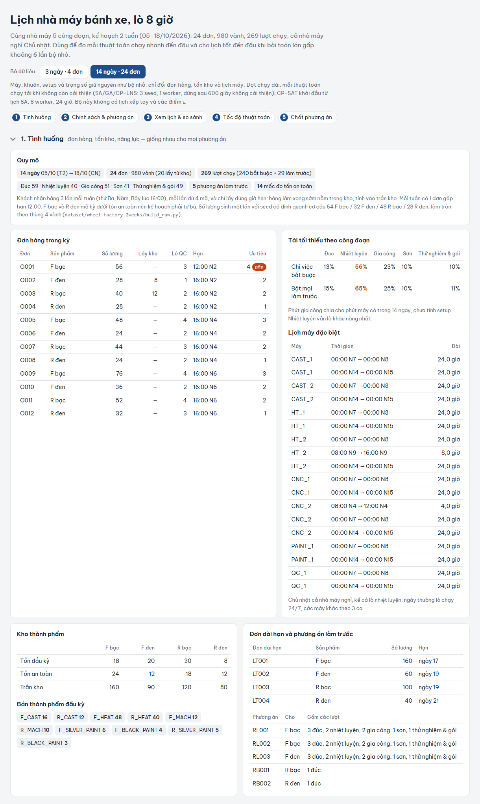

### 2.2. Chọn chính sách và phương án

Người lập kế hoạch chọn chính sách của kỳ (giao hàng trước, cân bằng, chi phí trước). Hệ thống chỉ giữ các lịch không bị lịch nào khác hơn ở cả ba mặt (trễ hạn, thiếu tồn an toàn, chi phí vận hành). Với bộ 2 tuần, trong 8 lịch đã sinh chỉ còn **một phương án đề xuất**: lịch của CP-SAT khởi đầu từ lịch SA, giao đúng hạn 24/24 đơn, thiếu tồn an toàn 8 vành, 46 ca-máy. Các lịch còn lại (chấm xám) đều kém hơn nó ở ít nhất một mặt và không hơn ở mặt nào.

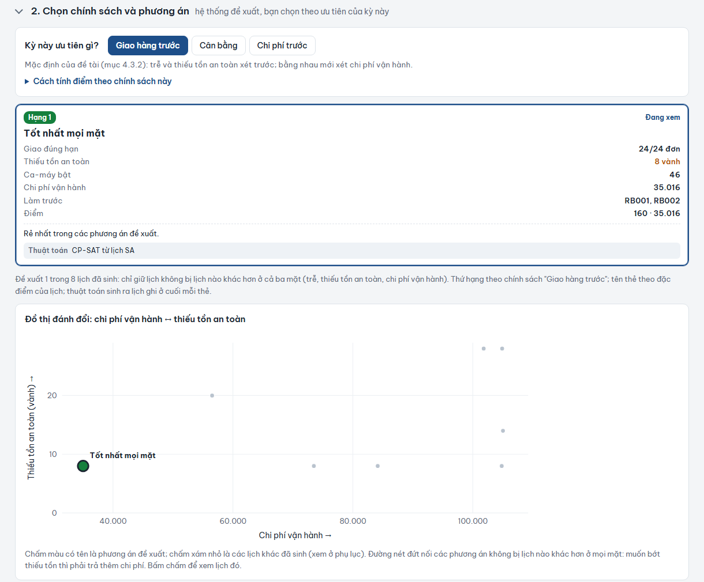

### 2.3. Xem lịch

Gantt theo máy của phương án đang xem, gồm 8 máy của 5 công đoạn: đúc, lò nhiệt luyện (mẻ 8 giờ, màu cam), gia công, sơn, thử nghiệm và đóng gói. Gantt có ca đang bật, giờ nghỉ, dừng máy, setup, bảo trì khuôn, lượt làm trước và mốc giao hàng. Hình 3 là 4 ngày đầu; trên màn hình kéo ngang để xem cả kỳ. Hình 4 là toàn kỳ ở dạng thu gọn.

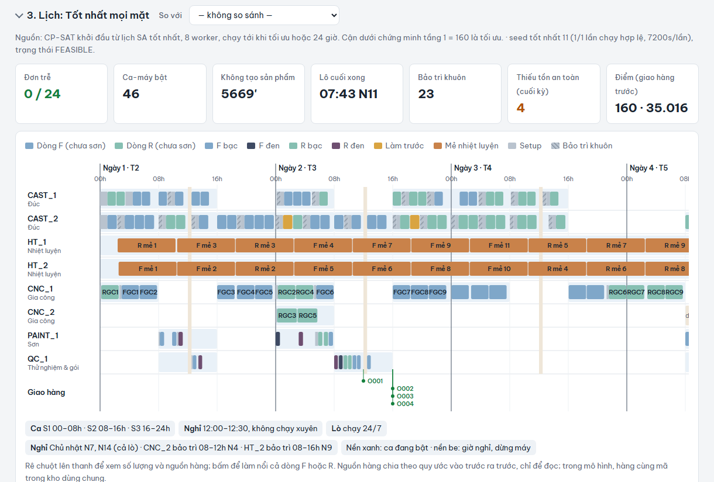

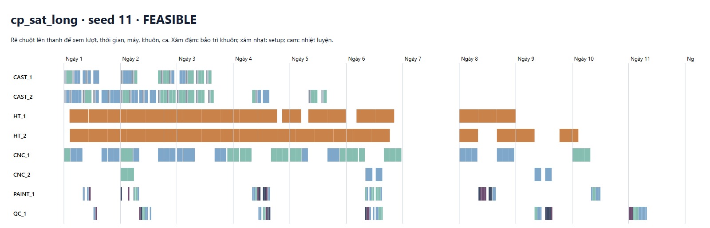

### 2.4. Tồn kho cuối kỳ

Với mỗi phương án, hệ thống tính tồn bán thành phẩm và thành phẩm từ đầu kỳ đến cuối kỳ, so với tồn an toàn, và chỉ ra phần bán thành phẩm còn dư do làm tròn theo cỡ lượt từng công đoạn.

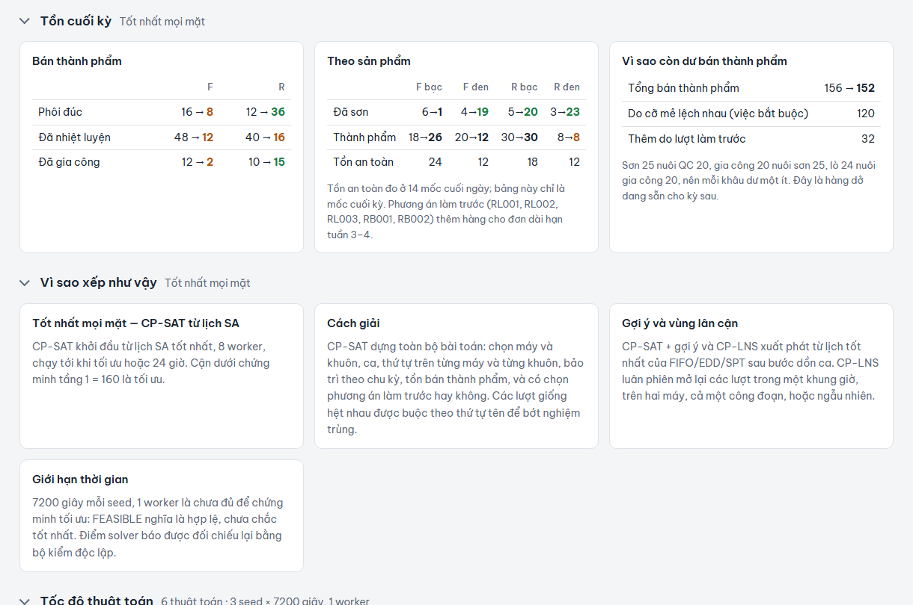

### 2.5. Tốc độ thuật toán

Đồ thị cho thấy điểm tốt nhất mỗi thuật toán tìm được theo thời gian chạy. Luật điều độ có lịch ngay; SA tìm được lịch không trễ sau khoảng 100 giây, GA sau khoảng 1.000 giây; CP-LNS không cải thiện được lịch EDD. Bảng bên dưới ghi số lần chạy hợp lệ, thời gian và điểm của từng thuật toán.

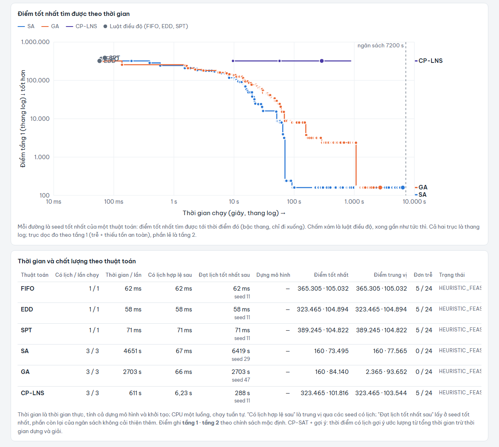

### 2.6. Chốt phương án

Bước cuối ghi lịch được chọn, chính sách và lý do chọn, để giải thích được về sau.

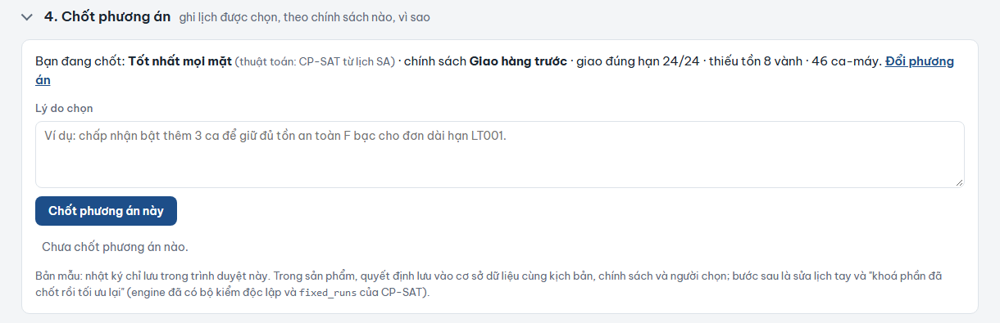

### 2.7. Sản phẩm web (backend + frontend)

Bàn điều độ ở Mục 2.1–2.6 hiện là **trang độc lập** đọc trực tiếp kết quả thực nghiệm (`report/demo/VoVanDung_Demo_2026-10-25.html`). Song song, sản phẩm web (backend FastAPI, frontend Next.js, giao diện song ngữ Việt/Anh) đã có đầy đủ các màn hình: tổng quan, dữ liệu nhà máy theo phiên bản, kế hoạch tổng hợp, bàn điều độ, lần chạy và chi tiết lịch. Tuy nhiên backend của sản phẩm **mới nhận dữ liệu dạng 4 công đoạn**, chưa nạp được bộ 5 công đoạn ở trên. Vì vậy các hình dưới đây chụp sản phẩm trên bộ dữ liệu mẫu cũ (4 công đoạn, 7 máy, 36 đơn), chỉ để minh hoạ chức năng. Đưa mô hình 5 công đoạn vào backend là việc đầu tiên của kế hoạch tiếp theo (Mục 4).

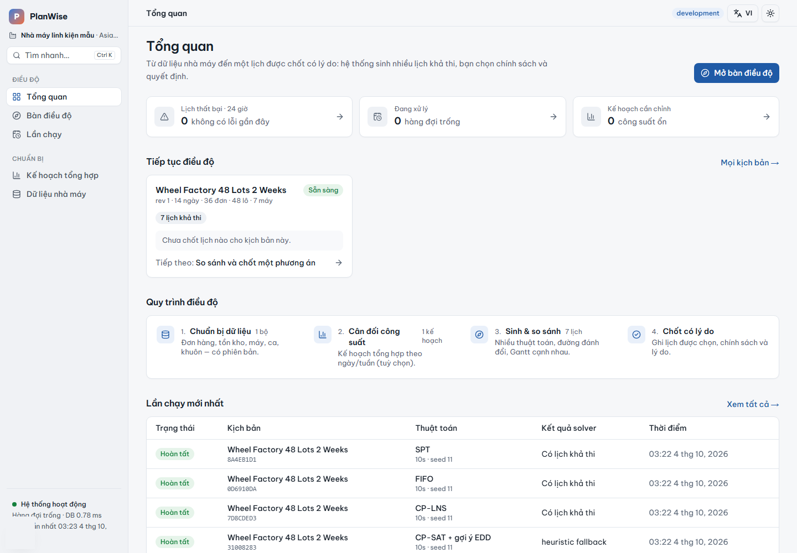

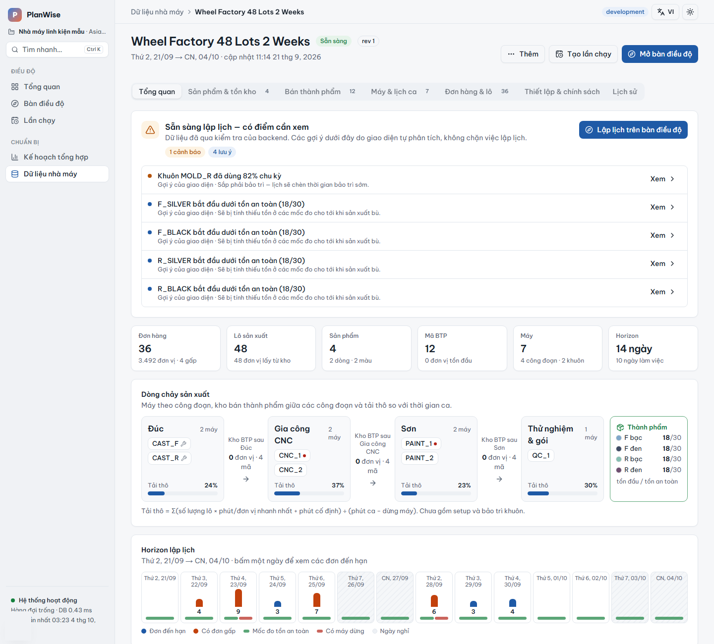

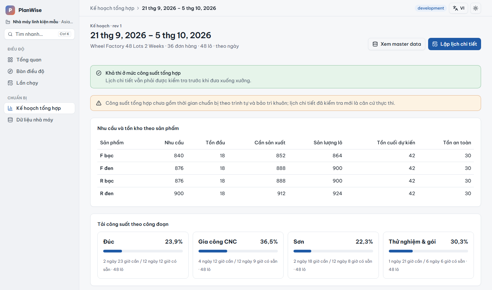

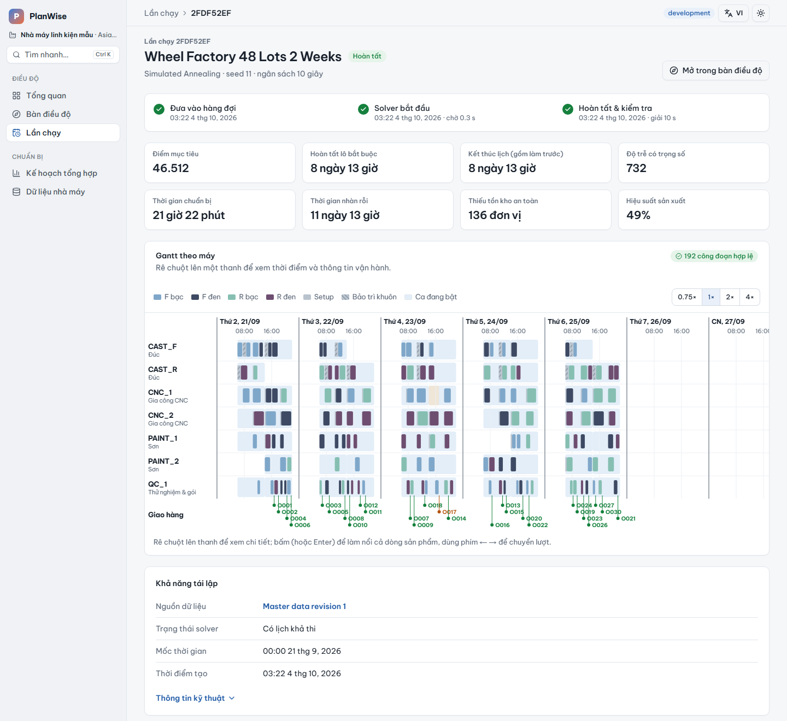

Các thay đổi khác của sản phẩm trong đợt này: thêm CP-SAT cuốn chiếu vào backend (9 thuật toán), thanh tìm nhanh (Ctrl K), giao diện sáng/tối, cấu hình triển khai lên Render.

## 3. Đối chiếu tiêu chí đánh giá

| Tiêu chí | Báo cáo 03/10 | Hiện tại |
|---|---|---|
| Lịch hợp lệ 100% | Đạt trên 2 bộ dữ liệu | Vẫn đạt: 16/16 lịch được xuất trong đợt chạy dài đều qua bộ kiểm tra; lần chạy không có lịch được báo rõ |
| Không trễ đơn trên bộ 2 tuần | Chưa đạt (tốt nhất 1 đơn trễ) | **Đạt** (SA, GA, CP-SAT khởi đầu từ lịch SA) |
| Hiệu suất máy ≥ 90% trong ca đã bật | Chưa đạt (28–52%) | Chưa đạt, nhưng tăng lên **73,6%** ở lịch tốt nhất. Vẫn cần định nghĩa lại theo công đoạn điểm nghẽn |
| Chứng minh chất lượng lời giải | Chưa có | Tầng 1 đã chứng minh tối ưu trên bộ 2 tuần; tầng 2 còn khoảng cách 51% |
| Người lập kế hoạch chọn và chốt phương án | Bản demo tĩnh | Bàn điều độ đã chạy trên bộ 5 công đoạn với kết quả thật; frontend sản phẩm cũng có, nhưng backend chưa nạp bộ 5 công đoạn. Nhật ký quyết định vẫn lưu ở trình duyệt |
| Chất lượng trên benchmark công khai | Chưa đánh giá | Chưa đánh giá |

## 4. Giới hạn và kế hoạch tiếp theo

**Giới hạn hiện tại:**

- Sản phẩm vẫn chạy trên mô hình 4 công đoạn cũ; mô hình 5 công đoạn (có nhiệt luyện, tồn bán thành phẩm theo công đoạn) mới có trong thư viện thực nghiệm.
- Mỗi bộ dữ liệu chỉ có một tập dữ liệu tổng hợp, CP-SAT chạy 1 lần, nên kết quả vẫn mang tính thăm dò.
- Nhật ký quyết định chốt phương án mới lưu trong trình duyệt, chưa lưu vào cơ sở dữ liệu.
- Chưa có tái lập lịch khi sự cố phát sinh giữa chừng; chưa chạy benchmark công khai.

**Kế hoạch:**

1. Đưa mô hình 5 công đoạn vào backend, chạy bàn điều độ trên bộ 2 tuần với quy trình B2 (SA) → B3 (CP-SAT khởi đầu từ lịch tốt nhất, giới hạn khoảng 10 phút).
2. Chạy lõi CP-SAT và luật điều độ trên Taillard và Lawrence, tính sai lệch tương đối so với lời giải tốt nhất đã công bố (RPD).
3. Cải thiện CP-SAT cuốn chiếu: thêm phạt dự báo trễ cho đơn ở cửa sổ sau; sửa CP-LNS chỉ dựng các lượt được mở.
4. Lưu quyết định chốt vào cơ sở dữ liệu; làm bước sửa tay, khoá phần đã chốt rồi tối ưu lại.
5. Tái lập lịch khi có đơn gấp hoặc máy hỏng giữa chừng.

Em kính mong cô góp ý về việc dùng thời gian chạy khoảng 10 phút cho bước CP-SAT trong sản phẩm, và về phạm vi đánh giá trên benchmark công khai.
